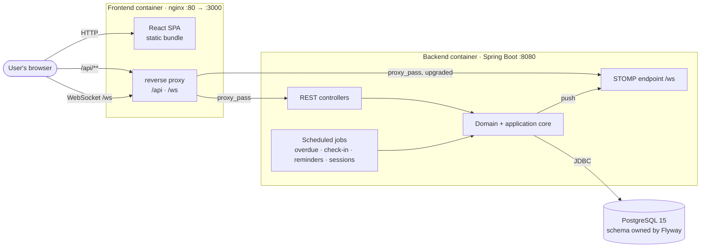

<div align="center">

# UpHealther

**Plan a health change, then find out whether it actually happened** — a tracker for habits,
experiments, goals and one-off health actions, for people who want structure without a coach.

[](https://github.com/NaimElijah/UpHealther/actions/workflows/ci.yml)
[](https://github.com/NaimElijah/UpHealther/commits/main)
[](LICENSE)

[Requirements](docs/requirements/requirements.md) ·
[Architecture](docs/architecture/architecture.md) ·
[Diagrams](docs/architecture/arch-diagrams/README.md) ·
[API](docs/api.md) ·
[Decisions](docs/ADRs/)

</div>



**Contents** · [🎯 What and why](#-what-and-why) · [✨ Features](#-features) ·
[🧱 Architecture](#-architecture) · [🧰 Tech stack](#-tech-stack) · [🚀 Quick start](#-quick-start) ·
[🔩 Configuration](#-configuration) · [📖 Usage](#-usage) · [💻 Development](#-development) ·
[🧪 Testing](#-testing) · [📡 Operations](#-operations) ·
[📁 Project structure](#-project-structure) · [🧭 Design decisions](#-design-decisions) ·
[🚦 Status and limitations](#-status-and-limitations) · [📜 Licence](#-licence)

---

## 🎯 What and why

People who decide to change a health habit rarely fail at the decision — they fail at knowing
whether the change survived contact with a normal week. UpHealther models each intended change as
an **upgrade** with an explicit lifecycle, so "did I actually do this?" is a query rather than a
memory: an upgrade is planned, activated, checked in against, and finally completed or abandoned,
and every one of those moves is a guarded transition rather than an editable status field.

> [!IMPORTANT]
> UpHealther is deliberately **not a medical application**. It gives no advice, diagnosis or
> treatment, and no feature may imply otherwise
> ([non-goal 5.1](docs/requirements/requirements.md#5-non-goals)).

## ✨ Features

- Create an upgrade — a habit, one-off action, routine, goal, experiment, product replacement,
  learning task, or medical or preventive errand — and file it under a health area you define
- Move it through a lifecycle the domain guards: `IDEA → PLANNED → ACTIVE ⇄ PAUSED → COMPLETED /
  ABANDONED`, where an illegal move is a 422 with a reason rather than a silent write
- Run each upgrade from its own page — edit or reschedule it, choose how it is measured, log the
  day, read its streak, set its reminders, and reflect on what worked and what to adjust
- Measure it as boolean, numeric, rating or text, and the server scores every entry against that
  choice rather than trusting the client's `completed` flag
- Check in on every active upgrade from one daily page, and look back over the last seven days
- Read a dashboard of what is active, planned, overdue and recently completed, with streaks and the
  last seven days' completion rate
- Receive reminders and notifications live over a WebSocket, stored so an offline client still sees
  them, and mark them read one at a time or all at once
- Sign out — on this device, immediately, and meaning it: the session is a row the server can end,
  not a token that stays valid until it expires
- Administer accounts: list them, switch one off or back on, and grant or revoke the administrator
  role — without being able to read what any account owns
- Pick a light, dark or system theme, applied before the first paint — no wrong-theme flash

## 🧱 Architecture

Three processes and a browser, shown above. No message broker, no cache, no third-party service:
every piece of state is in the one database, and every side effect is either a write to it or a
message pushed to a connected browser.

The backend is **ten bounded contexts over a shared kernel** — `auth`, `user`, `admin`, `healtharea`,
`upgrade`, `tracking`, `reflection`, `reminder`, `dashboard`, `notification` — each a hexagon:
adapters depend on the core, and the core depends on nothing outside itself. The graph between
them is acyclic, read off the `import` statements rather than drawn, and CI fails when it stops
matching the code — see the
[context map](docs/architecture/arch-diagrams/README.md#2-bounded-context-map).

**One request, end to end.** `POST /api/upgrades/{id}/progress` arrives at nginx and is proxied to
the API. `JwtAuthenticationFilter` hands the bearer token to `BearerTokenAuthenticator`, which has
`JwtTokenProvider` check its issuer, audience and algorithm, refuses it if its session has ended,
and re-loads the account by id — so a disabled or deleted account stops working on the next
request. `ProgressController` hands a command to `TrackingService`, which asks the `upgrade`
context for the upgrade *scoped to that user*: another user's row is a 404, not a 403. The service
refuses a second entry for the same day, scores the entry against the upgrade's tracking
configuration, and saves it through an outbound port the domain owns. Notifications are stored and
pushed by listeners that run only after the commit, so a rolled-back write announces nothing.

`HealthUpgrade` owns the state machine and has no setter for its status. `COMPLETED` is terminal;
`ABANDONED` is not — rescheduling revives it. At most three `HARD` upgrades may be `ACTIVE` at once,
checked both when activating one and when promoting a running one to `HARD`.

The layering is **enforced, not documented**: `HexagonalArchitectureTest` runs twelve ArchUnit rules
on every `./mvnw test` — the domain stays framework-free, the application depends on no adapter, and
Spring Data is confined to the persistence adapters.

Seven diagrams, outside in: [arch-diagrams](docs/architecture/arch-diagrams/README.md). The prose:
[architecture.md](docs/architecture/architecture.md). The why: [ADRs](docs/ADRs/).

## 🧰 Tech stack

| Layer | Technology | Version | Why |
|:---|:---|---:|:---|
| Language | Java | 21 | Records carry the commands, ports and DTOs — most of the boundary code |
| Framework | Spring Boot | 4.1.1 | Confined to the adapters; ArchUnit keeps it out of the domain ([ADR-032](docs/ADRs/ADR-032-the-backend-runs-on-spring-boot-4-1.md)) |
| Backend build | Maven, through `./mvnw` | 3.9.16 | Pinned and checksummed by the wrapper; the enforcer refuses any other Maven or JDK ([ADR-030](docs/ADRs/ADR-030-the-toolchain-is-pinned-in-the-repository.md)) |
| Auth | Spring Security + JJWT | 7.1.1 / 0.12.3 | A short-lived token renewed from a rotating cookie against a server-side session ([ADR-015](docs/ADRs/ADR-015-server-side-sessions-behind-a-rotating-refresh-cookie.md)) |
| Database | PostgreSQL | 15 | The partial unique constraint and optimistic locking are real constraints, not application checks |
| Migrations | Flyway | 12.4.0 | Owns the schema; Hibernate only validates against it and refuses to start on a mismatch |
| Observability | Micrometer Tracing, Logstash encoder | 1.7.1 / 9.0 | W3C `traceparent`, vendor-neutral; JSON logs with the trace id as a field ([ADR-007](docs/ADRs/ADR-007-request-correlation-through-micrometer-tracing.md)) |
| Frontend | React + TypeScript | 18.3.1 / 5.9.3 | Enums mirrored from the backend, with a test that fails when they drift |
| Routing | React Router | 6.30.6 | Held on 6 while its open advisories cannot reach the SPA ([ADR-034](docs/ADRs/ADR-034-stay-on-react-router-6-while-its-open-advisories-do-not-reach-the-spa.md)) |
| Build | Vite, on Node | 8.3.4 / 24.21.0 | The same `/api` and `/ws` proxy in dev as nginx serves in prod ([ADR-031](docs/ADRs/ADR-031-the-frontend-toolchain-runs-on-node-24-lts.md), [ADR-036](docs/ADRs/ADR-036-the-frontend-builds-on-vite-8-and-tests-on-vitest-5.md)) |
| Data fetching | TanStack Query | 5.100.10 | One cache, refreshed by every write rather than refetched by hand ([ADR-029](docs/ADRs/ADR-029-a-write-to-an-upgrade-refreshes-every-view-of-upgrades.md)) |
| Styling | Tailwind CSS | 3.4.19 | Semantic tokens only — `npm run check:colours` fails on a palette shade |
| Real-time | STOMP over WebSocket | 7.3.0 | Push authenticates with the same token, through a channel interceptor |
| Backend tests | JUnit, ArchUnit, Testcontainers | 6.0.3 / 1.5.1 / 2.0.5 | A real PostgreSQL in the integration suite; architecture rules as ordinary tests ([ADR-008](docs/ADRs/ADR-008-testcontainers-for-the-integration-test-database.md)) |
| Frontend tests | Vitest, on jsdom | 5.0.4 / 30.1.2 | Colocated with the code they test |
| Lint and format | palantir-java-format, ESLint, Prettier | 2.102.0 / 10.12.0 / 3.9.10 | Layout belongs to the formatters; javac's lint and ESLint fail on any warning ([ADR-035](docs/ADRs/ADR-035-the-frontend-lints-with-eslint-10-and-a-flat-config.md), [ADR-037](docs/ADRs/ADR-037-the-backend-is-formatted-by-palantir-java-format-through-spotless.md), [ADR-038](docs/ADRs/ADR-038-the-frontend-is-formatted-by-prettier.md), [ADR-039](docs/ADRs/ADR-039-the-backend-compiles-under-javacs-lint-and-fails-on-a-warning.md)) |

## 🚀 Quick start

**Prerequisites:** Docker 24+ with Compose v2. Nothing else — the toolchain runs in containers.

```bash
git clone https://github.com/NaimElijah/UpHealther.git && cd UpHealther
docker compose up --build   # with Node installed, `npm start` runs the same command
```

Frontend at **http://localhost:3000**, API at **http://localhost:8080**. Compose waits for the
backend to report *ready* before starting the frontend, so the first page load is never proxied to
an API still migrating its schema — expect roughly a minute on a cold build.

Sign in with the seeded demo account **`demo@healthupgrades.com` / `demo1234`**. Every variable has
a working default, so no `.env` is needed to start — copy `.env.example` to `.env` only to override.

<details>
<summary>If it does not come up</summary>

- **`port is already allocated` on 5432** — a host PostgreSQL owns the port. Stop it, or drop the
  `ports:` mapping on the `postgres` service; the backend reaches it over the compose network anyway.
- **Backend restarts, logs mention Flyway** — a stale `postgres_data` volume. `docker compose down -v`.
- **Frontend loads, every call fails** — `curl http://localhost:8080/actuator/health/readiness`.

</details>

## 🔩 Configuration

Mirrors [`.env.example`](.env.example). Nothing needs setting to run locally. A deployment must set
these four. `JWT_SECRET` has no default in the application at all, so a deployment without one refuses
to start; locally, compose and [`backend/config/application.yml`](backend/config/application.yml)
supply a published development key
([ADR-042](docs/ADRs/ADR-042-the-jar-carries-no-jwt-signing-key.md)). The other three's defaults suit
localhost only.

| Variable | Purpose | Default |
|---|---|---|
| `POSTGRES_PASSWORD` | Database password; compose hands it to the backend, a native run reads `DB_PASSWORD` | `healthupgrades` |
| `JWT_SECRET` | Token signing key; the application refuses to start without one, or on one under 256 bits | none — compose and `backend/config/` supply a published dev key |
| `ADMIN_BOOTSTRAP_USER_ID` | An existing account promoted to `ADMIN` at startup while no administrator exists — an id, not an email, because registration is open | empty |
| `TRUSTED_PROXIES` | Java regex for the hop allowed to set `X-Forwarded-For`; widen it and a caller picks the address the rate limit counts | nginx on the compose network |

<details>
<summary>The other fourteen variables, and six that live only in <code>application.yml</code></summary>

In `.env.example` order. `docker-compose.yml` does not pass four of them through, so they take
effect on a native run only — marked *native*.

| Variable | Purpose | Default |
|---|---|---|
| `POSTGRES_DB` | Database name created by the compose Postgres | `healthupgrades` |
| `POSTGRES_USER` | Database user created by the compose Postgres | `healthupgrades` |
| `JWT_ACCESS_TOKEN_TTL` | How long an access token is accepted; the SPA renews it, so this is not the session's length | `15m` |
| `AUTH_SESSION_IDLE` | A session lapses after this long unused; each refresh slides it forward | `7d` |
| `AUTH_SESSION_ABSOLUTE` | No session outlives this, however often it is refreshed | `30d` |
| `AUTH_RATE_LIMIT` | Sign-in and registration attempts per client address per window — *native* | `10` |
| `AUTH_RATE_LIMIT_WINDOW` | The window that limit counts over — *native* | `1m` |
| `DB_URL` | JDBC URL; compose points it at its own Postgres | `jdbc:postgresql://localhost:5432/healthupgrades` |
| `DB_USERNAME`, `DB_PASSWORD` | Credentials the backend connects with | `healthupgrades` |
| `CORS_ALLOWED_ORIGINS` | Cross-origin callers and `/ws` handshake origins; unused behind the proxy — *native* | `http://localhost:3000` |
| `SPRING_PROFILES_ACTIVE` | `json-logs` writes one JSON object per line; compose sets it | empty locally |
| `LOG_LEVEL_APP` | Level for `com.healthupgrades` only | `INFO` |
| `VITE_API_URL` | API origin for the SPA; empty uses the same-origin `/api` proxy — *native*, the image takes no build argument | empty |

Compose passes none of the next six either. Every cron is read in UTC, whatever the host's zone
([ADR-020](docs/ADRs/ADR-020-the-server-keeps-time-in-utc.md)): `UPGRADE_OVERDUE_CRON`
(`0 0 8 * * *`), `NOTIFY_CHECKIN_CRON` (`0 0 18 * * *`), `NOTIFY_REMINDERS_CRON` (`0 * * * * *`)
and `AUTH_SESSION_CLEANUP_CRON` (`0 30 3 * * *`); then `AUTH_SESSION_ROTATION_GRACE` (`10s`) and
`AUTH_RATE_LIMIT_MAX_CLIENTS` (`10000`).

</details>

## 📖 Usage

`POST /api/auth/login` with the demo credentials returns `200` and
`{ "accessToken": …, "expiresAt": …, "user": { "id", "name", "email", "role", "createdAt" } }`,
plus a `Set-Cookie` carrying the refresh credential. Export the access token as `$TOKEN`; every call
below sends it as a bearer. It lasts fifteen minutes: the browser renews it from the cookie unseen,
and at a terminal you sign in again, or `POST /api/auth/refresh` with the cookie and an
`X-Requested-With` header.

Create an upgrade — `201`, and it starts in `IDEA` because status moves only through the transition
endpoints:

```bash
curl -sX POST http://localhost:8080/api/upgrades \
  -H "Authorization: Bearer $TOKEN" -H 'Content-Type: application/json' \
  -d '{"title":"Walk 8k steps","type":"HABIT","difficulty":"MEDIUM"}'
```

The response carries all eighteen fields of the upgrade — nulls are serialised rather than omitted,
so a client can rely on every key being present. A complete request-and-response pair is in
[docs/api.md](docs/api.md#a-created-upgrade-in-full).

A move the state machine forbids is refused by the domain, not the controller — `422`, with the
`traceId` that finds the log line for it:

```bash
curl -sX POST "http://localhost:8080/api/upgrades/0f2c8f5a.../complete" \
  -H "Authorization: Bearer $TOKEN"
```

```json
{
  "message": "Only ACTIVE upgrades can be completed",
  "path": "/api/upgrades/0f2c8f5a.../complete",
  "status": 422,
  "timestamp": "2026-10-17T11:29:50.599299572",
  "traceId": "c9d0136e444d6791c64f4e0f093b2591"
}
```

The rest of the surface — every endpoint, the full status contract, and the error body — is in
[**docs/api.md**](docs/api.md).

## 💻 Development

Running natively needs **JDK 21**, **Node 24** (`frontend/.nvmrc` names the exact release; npm
refuses any Node outside `^24.16.0`), and a PostgreSQL 15 on `:5432`. Testing also needs **Python 3**,
for the diagram check, and **Docker**, for the integration tests. Maven is not a prerequisite:
`backend/mvnw` downloads the version the repository pins, checks its checksum and runs it
([ADR-030](docs/ADRs/ADR-030-the-toolchain-is-pinned-in-the-repository.md)). From PowerShell or
`cmd`, use `mvnw.cmd`.

The `npm` and `docker` commands below run from the repository root, the same in PowerShell, Git Bash
and a Linux shell ([ADR-044](docs/ADRs/ADR-044-one-root-package-json-runs-setup-start-and-test.md)).
The two `cd` lines are written for Git Bash or Linux. Windows PowerShell 5.1 has no `&&`, so there they
are `cd backend; .\mvnw.cmd spring-boot:run` and `cd frontend; npm run dev`.

```bash
npm run setup                               # once, and after the lockfile changes
docker compose up -d postgres               # or bring your own PostgreSQL

cd backend  && ./mvnw spring-boot:run        # terminal 1 — :8080, migrates on start
cd frontend && npm run dev                  # terminal 2 — :3000, proxies /api and /ws to :8080
```

**Migrations** are Flyway SQL in `backend/src/main/resources/db/migration`, named `V{n}__snake_case.sql`
and append-only — Hibernate validates the entities against the schema and refuses to start on a
mismatch, so an entity change needs a new migration rather than a `ddl-auto` change.

**Conventions.** Conventional Commits (`type(scope): imperative subject`), one logical change per
commit, on a `type/short-kebab-description` branch cut from `dev`. A PR merges into `dev`, and
`dev` → `main` is the release PR — both as merge commits, which keeps the SHAs in
[`.git-blame-ignore-revs`](.git-blame-ignore-revs) valid. Layout belongs to the formatters:
palantir-java-format for Java (`./mvnw spotless:apply`,
[ADR-037](docs/ADRs/ADR-037-the-backend-is-formatted-by-palantir-java-format-through-spotless.md)) and
Prettier for the frontend (`npm run format`,
[ADR-038](docs/ADRs/ADR-038-the-frontend-is-formatted-by-prettier.md)). Whitespace elsewhere belongs to
[`.editorconfig`](.editorconfig), and line endings to [`.gitattributes`](.gitattributes).

**Adding a feature end to end**, in the order the files come: behaviour into `domain/model` (or
`domain/service`) with a failing test; what it needs from outside into `domain/port/out`; a
`@Transactional` service in `application` with its command and result records in
`application/port/in`; the port implemented in `adapter/out/persistence`; the route in
`adapter/in/web` with a request record, DTO and mapper; the Flyway migration; then
`frontend/src/api` and the page. `HexagonalArchitectureTest` fails the build on any arrow that runs
the wrong way.

## 🧪 Testing

| Level | Covers | Command |
|---|---|---|
| Domain | The `HealthUpgrade` state machine and construction invariants, streaks, reminder scheduling, entry scoring | `./mvnw test` |
| Application | Every use case in every context, including what a *rejected* operation must not leave behind | `./mvnw test` |
| Web slice | Each controller against the real security chain: status codes, validation, another user's row as a 404 | `./mvnw test` |
| Structural | Fourteen ArchUnit rules, plus the frontend enum, column-bound and pinned-image contracts | `./mvnw test` |
| Integration | The app booted against a real PostgreSQL that Testcontainers starts — bean graph, migrations, database-enforced invariants | `./mvnw verify` |
| Frontend | Session restore and silent token renewal, the notification socket, the route and role gates, the administration page, the content security policy, theme, error boundary | `npm test` in `frontend/` |

```bash
npm test                # the whole CI gate, the four parts below in turn — needs Docker
npm run test:diagrams   # the generated diagrams still match their source
npm run test:frontend   # format check, lint, colour tokens, tests with coverage, audit, build
npm run test:backend    # ./mvnw clean verify: lint, unit and integration tests, format check
npm run test:images     # both images build, and the stack they make starts healthy
```

`test:images` runs as a throwaway compose project with no published ports, and takes it down again,
so your data volume is never touched. It does reuse the stack's fixed container names, so it refuses
to start while your own stack's containers exist: `docker compose down` first. Interrupted, it
leaves its containers holding those names, and your own `docker compose up` conflicts with them until
you run the check again, which clears them first, or `docker compose -p uphealther-images-check down
--volumes`. It needs a Compose that understands `!reset`
([ADR-045](docs/ADRs/ADR-045-ci-builds-and-starts-both-images.md)).

Inside a module the usual commands still work: `./mvnw test` in `backend/` needs neither a database
nor Docker, and `npm test` in `frontend/` runs Vitest once.

**What CI gates on** ([`ci.yml`](.github/workflows/ci.yml), on every push and PR to `main` and
`dev`): the same four `test:*` scripts, one job each, so `npm test` applies the same checks. Only
the inputs can differ: CI installs the dependencies fresh, and sets none of the variables
`docker-compose.yml` reads, which a root `.env` or your shell may
([ADR-044](docs/ADRs/ADR-044-one-root-package-json-runs-setup-start-and-test.md)). That is
`./mvnw clean verify`, which includes javac's lint at `-Werror` and the Java format check; the
generated diagrams still matching their source; the frontend format check; frontend lint at
`--max-warnings 0`; the colour-token check; `vitest run --coverage`; `npm audit --omit=dev
--audit-level=high`; the production build; and both images built, with the stack started from them
until every service reports healthy. A PR into `main` or `dev` cannot merge while any of the four
jobs is red or still running, whoever merges it
([ADR-043](docs/ADRs/ADR-043-ci-is-a-merge-gate.md)).

**Coverage is reported, never gated** — both suites publish one every run, and no threshold fails a
build. The gate is [`requirements.md`](docs/requirements/requirements.md), where each requirement
names the test that enforces it — or, for the few no test can observe, the check
([ADR-009](docs/ADRs/ADR-009-test-levels-boundaries-and-naming.md)).

## 📡 Operations

> [!NOTE]
> **Nothing is deployed.** This runs locally under Compose and has never run in a hosted
> environment, so there is no pipeline and no published image. What follows are facts about the
> code, not a description of a deployment.

| Concern | Where |
|---|---|
| Liveness | `GET /actuator/health/liveness` |
| Readiness | `GET /actuator/health/readiness` — not ready until Flyway has finished; the backend image's `HEALTHCHECK` polls it |
| Metrics | `GET /actuator/prometheus` — HTTP latency, error rate, JVM, HikariCP saturation, audit and scheduled-job counters |
| Traces | Micrometer Tracing over the OpenTelemetry bridge; sampled at 1.0, **no exporter configured**, so no span leaves the process |
| Logs | `docker logs` only — one JSON object per line under compose, Boot's readable pattern locally |
| Correlation | A trace id on every line, returned as the `X-Trace-Id` header and on the error body; two narrow gaps are under [Known constraints](docs/architecture/architecture.md#known-constraints) |
| Audit | The `AUDIT` logger — `action`, `outcome`, `resource`, `actorId`, `resourceId`; enums and identifiers only, never personal data |

Migrations run at application start, so a bad one leaves the container un-ready rather than
corrupting the schema. To chase a reported failure:
`docker logs healthupgrades-backend | grep <trace id>`.

## 📁 Project structure

```
backend/           Spring Boot API — ten bounded contexts, hexagonal, ArchUnit-enforced
  config/            application.yml read only by a run from backend/: the dev signing key, never packaged
  src/main/java/     com.healthupgrades.<context>/{domain,application,adapter} + common/
  src/main/resources/  application.yml, logback-spring.xml, db/migration/V{n}__*.sql
  src/test/java/     domain · application · web slice · architecture · *IT
frontend/          React + TypeScript SPA, served by nginx in production
  src/api/           Typed client per resource, the axios instance, error mapping
  src/pages/         One page per route; components/, contexts/, hooks/ alongside
docs/              The documentation the repository baseline requires
  requirements/      What the system must do, each naming its enforcing test
  architecture/      What the system is, plus seven diagrams (three generated)
  ADRs/              Why — one file per decision, append-only
scripts/           The image check, and the Maven and Python launchers that work in every shell
package.json       npm run setup, npm start, npm test — no dependencies; CI runs its test:* scripts
.github/workflows/ CI: backend verify, diagram drift, frontend format/lint/test/audit/build, images
```

## 🧭 Design decisions

**DDD + hexagonal, boundaries enforced by tests** ([ADR-001](docs/ADRs/ADR-001-ddd-hexagonal-architecture.md),
corrected by [ADR-002](docs/ADRs/ADR-002-close-the-gap-between-the-described-and-enforced-architecture.md))
— the lifecycle rules *are* the product, and service/repository layering scatters them where
nothing stops a controller reaching the database. **Cost:** many more types, so a small feature
touches more files; entities stay JPA-annotated, so the domain is not persistence-ignorant.

**A real PostgreSQL in the integration tests, started by the tests**
([ADR-008](docs/ADRs/ADR-008-testcontainers-for-the-integration-test-database.md)) — H2 was
rejected because the invariants that most need a real database, a partial unique constraint and
optimistic locking under concurrent writes, are where compatibility modes diverge; a CI service
container, because it keeps the two environments different. **Cost:** `./mvnw verify` needs Docker.

**Coverage is reported, never gated** ([ADR-009](docs/ADRs/ADR-009-test-levels-boundaries-and-naming.md))
— a threshold is met by tests written to move a number and says nothing about whether a rule is
enforced. **Cost:** the gate is a document, so it holds only while that table is maintained.

**The audit trail is a log stream, not a table** ([ADR-011](docs/ADRs/ADR-011-audit-as-a-log-stream.md))
— an `audit_log` table rolls back with the very refusal it was recording unless it gets its own
transaction, and Envers records versions of rows rather than attempts by people, so it cannot record
refusals at all. **Cost:** the container log's retention *is* the audit trail's retention.

**Source-available, not open source** ([ADR-003](docs/ADRs/ADR-003-proprietary-source-available-licensing.md))
— MIT and Apache-2.0 permit commercial reuse that was not intended, and AGPL is banned outright at
many organisations. **Cost:** nobody may run the code without written permission, which rules out
outside contribution.

## 🚦 Status and limitations

**Feature-complete and unshipped.** Every capability above works and is covered by tests at every
level, and `npm test` is green, but it has never run in a hosted environment, has no release tags, and
is versioned `0.0.1-SNAPSHOT`.

Known limitations, load-bearing rather than accidental:

- **Single instance only.** The STOMP broker is in memory, so a push reaches only clients on the
  instance that raised it; a second instance needs a broker relay first.
- **No backend dependency audit.** OWASP dependency-check needs an `NVD_API_KEY` to fill its
  database, and a check that always fails was judged worse than none; the frontend's shipped
  dependencies *are* audited on every run.
- **Observability stops at the process.** `docker logs` is the only sink, nothing scrapes
  `/actuator/prometheus`, no span leaves the process, and the SPA has no telemetry.
- **A live WebSocket outlives a sign-out until it reconnects.** Its session is checked when it
  connects and not again — and it only ever receives its own user's notifications.
- **The rate limit is per instance**, counted in process memory, so two instances double it
  ([ADR-017](docs/ADRs/ADR-017-an-in-process-fixed-window-rate-limit-per-client-address.md)).
- **Server time is UTC, and a user has no zone**, so a reminder set for 09:00 rings at 09:00 UTC
  wherever its owner is ([ADR-020](docs/ADRs/ADR-020-the-server-keeps-time-in-utc.md)).
- **The compose stack signs tokens with a published key** unless `JWT_SECRET` is set.
  `docker-compose.yml` is the local stack, not a deployment; the image itself carries no key
  ([ADR-042](docs/ADRs/ADR-042-the-jar-carries-no-jwt-signing-key.md)).
- **The demo account ships with a published password**, seeded into every environment by migration:
  convenient for a clone, wrong for anything reachable.
- **No screenshots yet.** The system-context diagram stands in until the UI is captured.

What comes next is tracked as four open epics: running in production on AWS
([#198](https://github.com/NaimElijah/UpHealther/issues/198)), readiness for public sign-up
([#199](https://github.com/NaimElijah/UpHealther/issues/199)), a visual identity of the interface's
own ([#226](https://github.com/NaimElijah/UpHealther/issues/226)), and the rest of the repository
baseline ([#197](https://github.com/NaimElijah/UpHealther/issues/197)). Sharing, accountability
partners and a public API are **non-goals** rather than backlog
([§5](docs/requirements/requirements.md#5-non-goals)).

## 🤝 Contributing

Outside contribution is not possible under the licence below — the code may be read, not modified.
Corrections and questions are welcome as [issues](https://github.com/NaimElijah/UpHealther/issues).

---

## 📜 Licence

> [!IMPORTANT]
> UpHealther is **source-available, not open source**. Reading, reviewing and evaluating it is the
> whole of the permission granted — it may not be used, copied, modified, run or redistributed.

**Copyright © 2026 Naim Elijah. All rights reserved.** Anything beyond reading — using, copying,
modifying, running, deploying, redistributing, or training a model on it — needs written permission,
via [github.com/NaimElijah](https://github.com/NaimElijah); an unanswered request is a refused one.
[`LICENSE`](LICENSE) carries the terms that govern. Third-party dependencies remain under their own.

## 🙏 Acknowledgements

The ADR format is Michael Nygard's; the ports-and-adapters shape is Alistair Cockburn's, and the
context boundaries Eric Evans' *Domain-Driven Design*.
