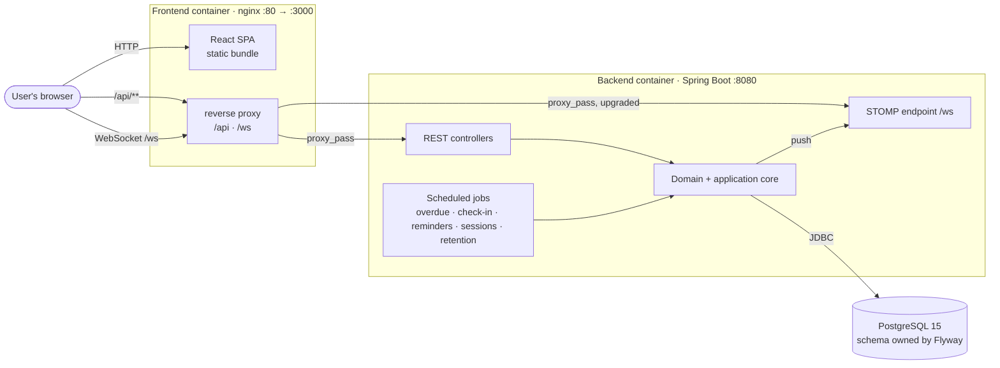

<div align="center">

# UpHealther

Plan a health change, then find out whether it actually happened — a tracker for habits,
experiments, goals and one-off health actions, for people who want structure without a coach.

[](https://github.com/NaimElijah/UpHealther/actions/workflows/ci.yml)
[](https://github.com/NaimElijah/UpHealther/commits/main)
[](LICENSE)

[Requirements](docs/requirements/requirements.md) · [Architecture](docs/architecture/architecture.md) ·
[Diagrams](docs/architecture/arch-diagrams/README.md) · [API](docs/api.md) · [Decisions](docs/ADRs/) ·
[Changelog](CHANGELOG.md)

</div>



**Contents** · [What and why](#what-and-why) · [Features](#features) ·
[Architecture](#architecture) · [Tech stack](#tech-stack) · [Quick start](#quick-start) ·
[Configuration](#configuration) · [Usage](#usage) · [Development](#development) ·
[Testing](#testing) · [Operations](#operations) · [Project structure](#project-structure) ·
[Design decisions](#design-decisions) · [Status and limitations](#status-and-limitations) ·
[Licence and contributing](#licence-and-contributing)

## What and why

People who decide to change a health habit rarely fail at the decision — they fail at knowing
whether the change survived contact with a normal week. UpHealther models each intended change as an
upgrade with an explicit lifecycle, so "did I actually do this?" is a query rather than a memory: an
upgrade is planned, activated, checked in against, and finally completed or abandoned, and every one
of those moves is a guarded transition rather than an editable status field.

> [!IMPORTANT]
> UpHealther is deliberately **not a medical application**. It gives no advice, diagnosis or
> treatment, and no feature may imply otherwise ([non-goal 5.1](docs/requirements/requirements.md#5-non-goals)).

## Features

- Create an upgrade — a habit, one-off action, routine, goal, experiment, product replacement,
  learning task, or medical or preventive errand — and file it under a health area you define
- Move it through a lifecycle: `IDEA → PLANNED → ACTIVE ⇄ PAUSED`, `ACTIVE → COMPLETED`, and any
  open state `→ ABANDONED`, which rescheduling revives; an illegal move is a 422 with a reason
- Measure it as boolean, numeric, rating or text; the server scores every entry against that choice
  rather than trusting the client's `completed` flag
- Run each upgrade from its own page — edit or reschedule it, log the day, read its streak, set
  reminders, reflect — and check in on every active one from a daily page, with the last seven days
- Read a dashboard of what is active, planned, overdue and recently completed, with streaks and the
  last seven days' completion rate
- Receive reminders and notifications live over a WebSocket, stored so an offline client still sees
  them, and mark them read one at a time or all at once
- Sign out on this device, immediately: the session is a row the server can end. Pick a light, dark
  or system theme, applied before the first paint
- Administer accounts — list, switch off or on, grant or revoke the administrator role — without
  reading what any account owns

Every capability is listed in [requirements §2](docs/requirements/requirements.md#2-functional-requirements).

## Architecture

Three processes and a browser, shown above. No message broker, no cache, no third-party service: all
state is in the one database, and every side effect is a write to it or a push to a browser.

The backend is ten bounded contexts over a shared kernel — `auth`, `user`, `admin`, `healtharea`,
`upgrade`, `tracking`, `reflection`, `reminder`, `dashboard`, `notification` — each a hexagon:
adapters depend on the core, and the core imports no adapter. The graph between them is acyclic and
read off the imports ([context map](docs/architecture/arch-diagrams/README.md#2-bounded-context-map)).
`HexagonalArchitectureTest` runs twenty-eight ArchUnit rules on every `./mvnw test`. More in
[architecture.md](docs/architecture/architecture.md) and the [ADRs](docs/ADRs/).

**One request, end to end.** `POST /api/upgrades/{id}/progress` arrives at nginx and is proxied to
the API. `JwtAuthenticationFilter` hands the bearer token to `BearerTokenAuthenticator`, which has
`JwtTokenProvider` check its issuer, audience and algorithm, refuses it if its session has ended,
and re-loads the account by id, so a disabled account stops working on the next request.
`ProgressController` hands a command to `TrackingService`, which asks the `upgrade` context for the
upgrade *scoped to that user* (another user's row is a 404, not a 403), refuses a second entry for
the day, scores the entry against the tracking configuration and saves it through a port the domain
owns. Notifications are pushed by listeners that run after the commit, so a rollback announces
nothing.

## Tech stack

| Layer | Technology | Version | Why |
|:---|:---|---:|:---|
| Language, framework | Java, Spring Boot | 21 / 4.1.1 | Records carry the boundary code; Spring stays out of the domain ([ADR-032](docs/ADRs/ADR-032-the-backend-runs-on-spring-boot-4-1.md)) |
| Backend build | Maven, through `./mvnw` | 3.10.0 | Pinned and checksummed; the enforcer refuses any other Maven or JDK ([ADR-030](docs/ADRs/ADR-030-the-toolchain-is-pinned-in-the-repository.md)) |
| Auth | Spring Security + JJWT | 7.1.1 / 0.13.0 | Short-lived token, rotating refresh cookie ([ADR-015](docs/ADRs/ADR-015-server-side-sessions-behind-a-rotating-refresh-cookie.md)) |
| Database | PostgreSQL, Flyway | 15 / 12.4.0 | Flyway owns the schema; Hibernate only validates it |
| Observability | Micrometer Tracing, Logstash encoder | 1.7.1 / 9.0 | W3C `traceparent`, vendor-neutral; JSON logs ([ADR-007](docs/ADRs/ADR-007-request-correlation-through-micrometer-tracing.md)) |
| Frontend | React, TypeScript, React Router | 18.3.1 / 5.9.3 / 6.30.6 | Wire types generated from the backend's records ([ADR-053](docs/ADRs/ADR-053-the-frontends-wire-types-are-generated-from-the-apis-records.md)) |
| Build | Vite, on Node | 8.3.4 / 24.22.0 | Dev proxy matches nginx's `/api` and `/ws` ([ADR-036](docs/ADRs/ADR-036-the-frontend-builds-on-vite-8-and-tests-on-vitest-5.md)) |
| Data fetching | TanStack Query | 5.104.3 | One cache, refreshed by every write ([ADR-029](docs/ADRs/ADR-029-a-write-to-an-upgrade-refreshes-every-view-of-upgrades.md)) |
| Styling | Tailwind CSS | 3.4.19 | Semantic tokens only; `npm run check:colours` fails on a palette shade |
| Real-time | STOMP over WebSocket, `@stomp/stompjs` client | 7.5.0 | Spring's in-memory simple broker; push authenticates with the same token |
| Backend tests | JUnit, ArchUnit, Testcontainers | 6.0.3 / 1.5.1 / 2.0.5 | A real PostgreSQL in the integration suite ([ADR-008](docs/ADRs/ADR-008-testcontainers-for-the-integration-test-database.md)) |
| Frontend and smoke tests | Vitest on jsdom; Playwright in Chromium | 5.0.5 / 30.1.3; 1.64.1 | Colocated tests; one browser run through the stack ([ADR-052](docs/ADRs/ADR-052-a-playwright-smoke-suite-drives-the-stack-the-image-check-starts.md)) |
| Lint and format | palantir-java-format, ESLint, Prettier | 2.102.0 / 10.13.0 / 3.9.10 | Warnings fail the build ([ADR-039](docs/ADRs/ADR-039-the-backend-compiles-under-javacs-lint-and-fails-on-a-warning.md)) |

## Quick start

**Prerequisites:** Docker with Compose v2, and on Linux Docker Engine 28.3.3 or later. Nothing else.

```bash
git clone https://github.com/NaimElijah/UpHealther.git && cd UpHealther
docker compose up --build   # with Node installed, `npm start` runs the same command
```

Frontend at http://localhost:3000, API at http://localhost:8080. From built images all three
services were healthy 55 seconds after `docker compose up` on a fresh volume (one machine, 2026-11-01);
the first build takes longer, and CI builds both images, starts the stack and runs the browser suite
in about three minutes ([ADR-052](docs/ADRs/ADR-052-a-playwright-smoke-suite-drives-the-stack-the-image-check-starts.md)).
The page is ready when `docker compose ps` shows all three services `healthy`. The ports are
published on `127.0.0.1` only, because their defaults are published credentials, so another device
on your network cannot reach the stack; on Linux that needs Engine 28.3.3 ([ADR-057](docs/ADRs/ADR-057-the-developer-stack-is-reachable-from-this-machine-only.md)).

Sign in with the demo account `demo@healthupgrades.com` / `demo1234`, which the stack creates on
its first start ([ADR-085](docs/ADRs/ADR-085-the-jar-creates-no-account-of-its-own.md)). Every variable
has a working default, so no `.env` is needed to start — copy `.env.example` to `.env` only to override.

**If it does not come up.**

- **`port is already allocated` on 5432** — a host PostgreSQL owns the port. Stop it while you
  evaluate: editing `docker-compose.yml` makes the copy modified, which `LICENSE` §3.4 does not cover.
- **Backend exits, logs mention Flyway, `password authentication failed` or `permission denied`** —
  a stale `postgres_data` volume ([ADR-069](docs/ADRs/ADR-069-the-compose-backend-connects-as-a-role-that-owns-its-database.md)).
  `docker compose down -v` and start again; this deletes the local data, the demo account included,
  which the next start creates again.
- **Frontend loads, every call fails** — `curl http://localhost:8080/actuator/health/readiness`.

## Configuration

The four variables a deployment reads first, from [`.env.example`](.env.example). Nothing needs
setting to run locally. Only `JWT_SECRET` is required: it has no default, so a deployment without
one refuses to start; locally, compose and `backend/config/` supply a published development key
([ADR-042](docs/ADRs/ADR-042-the-jar-carries-no-jwt-signing-key.md)). `ADMIN_BOOTSTRAP_USER_ID` is
empty by default, and empty means do nothing. The other two have defaults that suit the local stack
only, so a deployment sets them.

| Variable | Purpose | Default | Required |
|---|---|---|:-:|
| `POSTGRES_PASSWORD` | The compose PostgreSQL's superuser password | `healthupgrades` | In a deployment |
| `JWT_SECRET` | Token signing key, at least 256 bits | none; compose and `backend/config/` supply a dev key | Yes |
| `ADMIN_BOOTSTRAP_USER_ID` | Account id promoted to `ADMIN` while no administrator exists | empty: do nothing | No |
| `TRUSTED_PROXIES` | Java regex for the hop trusted to set `X-Forwarded-*` | nginx on the compose network | In a deployment |

The other twenty-six variables, none required: [architecture.md](docs/architecture/architecture.md#the-other-configuration-variables).

## Usage

For Git Bash or a Linux or macOS shell, with only `curl` and `sed`, against the running stack. Sign
in as the demo account and keep the access token:

```bash
TOKEN=$(curl -s -X POST http://localhost:8080/api/auth/login \
  -H 'Content-Type: application/json' \
  -d '{"email":"demo@healthupgrades.com","password":"demo1234"}' \
  | sed -E 's/.*"accessToken":"([^"]+)".*/\1/')
```

It answers `200` with
`{ "accessToken": …, "expiresAt": …, "user": { "id", "name", "email", "role", "createdAt" } }` and a
`Set-Cookie` for the refresh credential, `__Host-refresh_token`. The token lasts fifteen minutes:
the browser renews it unseen, and at a terminal you sign in again, or `POST /api/auth/refresh` with
the cookie and an `X-Requested-With` header.

Create an upgrade — `201`, in `IDEA`, because status moves only through the transition endpoints —
and keep its `id`:

```bash
ID=$(curl -s -X POST http://localhost:8080/api/upgrades \
  -H "Authorization: Bearer $TOKEN" -H 'Content-Type: application/json' \
  -d '{"title":"Walk 8k steps","type":"HABIT","difficulty":"MEDIUM"}' \
  | sed -E 's/^\{"id":"([^"]+)".*/\1/')
```

The response carries all eighteen fields, nulls included ([the full pair](docs/api.md#a-created-upgrade-in-full)).
A move the state machine forbids is refused by the domain — `422`, with the `traceId` that finds the
log line. An `IDEA` cannot be completed:

```bash
curl -s -X POST "http://localhost:8080/api/upgrades/$ID/complete" \
  -H "Authorization: Bearer $TOKEN"
```

```json
{
  "message": "Only ACTIVE upgrades can be completed",
  "path": "/api/upgrades/bc6e99dd-eae6-4602-a91d-ddfa44dcfcd8/complete",
  "status": 422,
  "timestamp": "2026-11-01T17:37:53.7230967",
  "traceId": "fbaa61c2ef9e6e9c321bd7680d52981e"
}
```

Your `id`, `timestamp` and `traceId` differ. Every endpoint is in [docs/api.md](docs/api.md).

## Development

Running natively needs JDK 21, Node 24 (`frontend/.nvmrc` names the release; npm refuses any outside
`^24.16.0`) and a PostgreSQL 15 on `:5432`; testing also needs Python 3 (diagram check) and Docker
(integration tests). Maven comes with the `./mvnw` wrapper. The commands run from the repository
root, the same in PowerShell, Git Bash and Linux ([ADR-044](docs/ADRs/ADR-044-one-root-package-json-runs-setup-start-and-test.md));
the `cd` lines are for Git Bash or Linux. In PowerShell 5.1, which has no `&&`, use
`cd backend; .\mvnw.cmd spring-boot:run` and `cd frontend; npm run dev`.

```bash
npm run setup                    # once per clone, and after a lockfile changes
docker compose up -d postgres    # or bring your own PostgreSQL
cd backend  && ./mvnw spring-boot:run   # terminal 1: :8080, migrates on start
cd frontend && npm run dev              # terminal 2: :3000, proxies /api and /ws
```

A native `./mvnw spring-boot:run` listens on every interface while it holds the published signing
key ([#366](https://github.com/NaimElijah/UpHealther/issues/366)), so another computer on your
network can reach it, and `LICENSE` §3.4 does not cover a copy another computer can reach. To
evaluate, use Quick start's compose stack, which binds `127.0.0.1` only, or run natively only where
a firewall blocks inbound `:8080`.

**Migrations.** Flyway SQL in `backend/src/main/resources/db/migration`, named
`V{n}__snake_case.sql` and append-only: Hibernate validates the entities against the schema and
refuses to start on a mismatch, so an entity change needs a new migration rather than a `ddl-auto`
change, and one a demo row meets updates `backend/config/db/demo` too
([ADR-085](docs/ADRs/ADR-085-the-jar-creates-no-account-of-its-own.md)).

**Common-password list.** The list that registration refuses (BR-17) is public on purpose: it holds
passwords that are already public. `scripts/derive_common_passwords.py` derives it again, and
`--check` compares ([ADR-071](docs/ADRs/ADR-071-registration-refuses-the-most-common-passwords.md)).

**Conventions.** Conventional Commits, one logical change per commit, on a
`type/short-kebab-description` branch cut from `dev`; a PR merges into `dev`, and `dev` → `main` is
the release PR, both as merge commits ([`.git-blame-ignore-revs`](.git-blame-ignore-revs) depends on
that). The formatters own layout: `./mvnw spotless:apply` in `backend/` ([ADR-037](docs/ADRs/ADR-037-the-backend-is-formatted-by-palantir-java-format-through-spotless.md)),
`npm run format` in `frontend/` ([ADR-038](docs/ADRs/ADR-038-the-frontend-is-formatted-by-prettier.md)).

**A feature end to end.** In the order the files come: behaviour into `domain/model` with a failing
test; its ports in `domain/port/out`; a `@Transactional` service in `application`; the adapter in
`adapter/out/persistence`; the route in `adapter/in/web`; the Flyway migration; then
`npm run generate:wire-types` ([ADR-053](docs/ADRs/ADR-053-the-frontends-wire-types-are-generated-from-the-apis-records.md))
and the page.

## Testing

| Level | Covers | Command |
|---|---|---|
| Unit and slice | State machine, every use case, each controller on the real security chain; no database or Docker | `./mvnw test` in `backend/` |
| Structural | Thirty-one ArchUnit rules (twenty-eight hexagonal, three on server time); the wire-type, column-bound, pinned-image and version contracts | `./mvnw test` in `backend/` |
| Integration | The app against a Testcontainers PostgreSQL: migrations, database-enforced invariants | `./mvnw verify` in `backend/` |
| Frontend | Session restore, silent token renewal, the socket, route and role gates, CSP, theme | `npm test` in `frontend/` |
| Smoke | A browser drives both modules through the composed stack, under nginx's CSP | `npm run test:images` |

```bash
npm test                # the whole CI gate, the four parts below in turn — needs Docker
npm run test:diagrams   # the generated diagrams still match their source
npm run test:frontend   # format, lint, colour tokens, coverage tests, audit, build
npm run test:backend    # ./mvnw clean verify, then the dependency audit
npm run test:images     # build both images, start the stack, drive it with a browser
```

`test:images` runs as a throwaway compose project and publishes only the frontend, on
`127.0.0.1:3000`. It needs Compose 2.24.4 or later ([`scripts/check-images.mjs`](scripts/check-images.mjs)).
It refuses to start while something answers on 3000 or your own stack's containers exist
(`docker compose down` first); an interrupted run is cleared by the next one, or by
`docker compose -p uphealther-images-check down --volumes` ([ADR-045](docs/ADRs/ADR-045-ci-builds-and-starts-both-images.md),
[ADR-052](docs/ADRs/ADR-052-a-playwright-smoke-suite-drives-the-stack-the-image-check-starts.md)).

CI ([`ci.yml`](.github/workflows/ci.yml)) runs the same four `test:*` scripts, one job each, on
every push and PR to `main` and `dev`, and a PR cannot merge while any is red or running ([NFR-12](docs/requirements/requirements.md),
[ADR-043](docs/ADRs/ADR-043-ci-is-a-merge-gate.md), [ADR-044](docs/ADRs/ADR-044-one-root-package-json-runs-setup-start-and-test.md)).
Dependencies move by Dependabot ([ADR-046](docs/ADRs/ADR-046-dependabot-proposes-weekly-updates-into-dev.md)).
Coverage is reported, never gated: each requirement names the test that enforces it ([ADR-009](docs/ADRs/ADR-009-test-levels-boundaries-and-naming.md)).

## Operations

Nothing is deployed: this runs locally under Compose and has never run in a hosted environment, so
there is no pipeline and no published image.

| Concern | Where |
|---|---|
| Health | `GET /actuator/health/liveness` and `/readiness`; readiness waits for Flyway, so a bad migration leaves the container un-ready rather than corrupting the schema |
| Metrics | `GET /actuator/prometheus` — HTTP latency, error rate, JVM, HikariCP saturation, audit and job counters; nothing scrapes it |
| Traces | Micrometer Tracing over the OpenTelemetry bridge; sampled at 1.0, no exporter configured; the SPA sends no telemetry |
| Logs | `docker logs` only, JSON per line under compose; a trace id on every line ([two gaps](docs/architecture/architecture.md#known-constraints)), so `docker logs healthupgrades-backend \| grep <trace id>` finds a request |
| Audit | The `AUDIT` logger — `action`, `outcome`, `resource`, `actorId`, `resourceId`; never personal data |

### Releasing

A release is an annotated `v<version>` tag on the promotion merge to `main`, with its
[`CHANGELOG.md`](CHANGELOG.md) section written by git-cliff ([ADR-050](docs/ADRs/ADR-050-one-version-names-the-whole-repository.md),
[ADR-051](docs/ADRs/ADR-051-a-release-is-a-tag-on-its-promotion-and-git-cliff-writes-its-changelog.md));
the steps are in [docs/releasing.md](docs/releasing.md).

## Project structure

```text
backend/      Spring Boot API: ten bounded contexts; config/ = the unpackaged dev key
frontend/     React + TypeScript SPA, served by nginx in production
e2e/          Playwright smoke suite: a browser through the composed stack
docs/         requirements/, architecture/ (seven diagrams), ADRs/, api.md, releasing.md
scripts/      Image check, audit, git-cliff, launchers, postgres-init/, password list
```

## Design decisions

**DDD + hexagonal, boundaries enforced by tests** ([ADR-001](docs/ADRs/ADR-001-ddd-hexagonal-architecture.md),
corrected by [ADR-002](docs/ADRs/ADR-002-close-the-gap-between-the-described-and-enforced-architecture.md))
— the lifecycle rules *are* the product, and layered services scatter them. **Cost:** many more
types, and entities stay JPA-annotated, so the domain is not persistence-ignorant.

**The audit trail is a log stream, not a table** ([ADR-011](docs/ADRs/ADR-011-audit-as-a-log-stream.md))
— an `audit_log` row rolls back with the very refusal it records, and Envers cannot record refusals
at all. **Cost:** the container log's retention *is* the audit trail's retention.

**Source-available, not open source** ([ADR-003](docs/ADRs/ADR-003-proprietary-source-available-licensing.md))
— MIT and Apache-2.0 permit commercial reuse that was not intended, and AGPL is banned at many
organisations. **Cost:** an evaluator may run an unmodified copy ([ADR-084](docs/ADRs/ADR-084-the-licence-permits-running-an-unmodified-copy-to-evaluate-it.md)),
but nobody may modify, host or reuse it.

## Status and limitations

**Feature-complete and unshipped.** Every capability above is implemented and covered by tests at
every level, and `npm test` is green, but it has never run in a hosted environment, and some defects
are known: the [open bugs](https://github.com/NaimElijah/UpHealther/issues?q=is%3Aopen+label%3A%22type%3A+bug%22).
The limitations below are load-bearing rather than accidental:

- **Single instance only.** The STOMP broker and the rate limits are in process memory, so a push
  reaches only clients on its instance and two instances double the limits ([ADR-017](docs/ADRs/ADR-017-an-in-process-fixed-window-rate-limit-per-client-address.md)).
- **A WebSocket outlives a session that idles out** until it reconnects ([#331](https://github.com/NaimElijah/UpHealther/issues/331),
  [ADR-054](docs/ADRs/ADR-054-a-session-that-ends-closes-its-open-sockets.md)).
- **Server time is UTC, and a user has no zone**, so a reminder rings at its time in UTC
  ([ADR-020](docs/ADRs/ADR-020-the-server-keeps-time-in-utc.md)).
- **The compose stack signs tokens with a published key** unless `JWT_SECRET` is set; it is the
  local stack, not a deployment ([ADR-042](docs/ADRs/ADR-042-the-jar-carries-no-jwt-signing-key.md)).
- **A native backend run is reachable from the network.** `./mvnw spring-boot:run` listens on every
  interface while holding that key ([#366](https://github.com/NaimElijah/UpHealther/issues/366)),
  so another computer may reach it, which `LICENSE` §3.4 does not permit. The composed stack binds
  `127.0.0.1` only.
- **The local stack's demo account has a published password.** Compose and a run from `backend/`
  create it from a seed in `backend/config/`; the jar and the image carry no seed, so a deployment holds
  no account anyone did not register, even with compose's Flyway setting copied into it
  ([ADR-085](docs/ADRs/ADR-085-the-jar-creates-no-account-of-its-own.md)).
- **React, React Router, Tailwind and TypeScript sit a major behind**, held until their migrations
  ([ADR-048](docs/ADRs/ADR-048-dependabot-holds-react-majors-back.md),
  [ADR-060](docs/ADRs/ADR-060-dependabot-holds-the-tailwind-and-typescript-majors-back.md)); React
  Router 6 also while its open advisories do not reach the SPA
  ([ADR-034](docs/ADRs/ADR-034-stay-on-react-router-6-while-its-open-advisories-do-not-reach-the-spa.md)).
- **No screenshots yet.** The container diagram at the top stands in until the UI is captured
  ([#419](https://github.com/NaimElijah/UpHealther/issues/419)).

Five open epics track what comes next: production on AWS ([#198](https://github.com/NaimElijah/UpHealther/issues/198)),
public sign-up ([#199](https://github.com/NaimElijah/UpHealther/issues/199)), a visual identity
([#226](https://github.com/NaimElijah/UpHealther/issues/226)), learning from a user's own history
while proving it gives no medical advice ([#271](https://github.com/NaimElijah/UpHealther/issues/271)),
and the rest of the repository baseline ([#197](https://github.com/NaimElijah/UpHealther/issues/197)).
Sharing and a public API are non-goals ([§5](docs/requirements/requirements.md#5-non-goals)).

## Licence and contributing

> [!IMPORTANT]
> UpHealther is **source-available, not open source**. Reading, reviewing and evaluating it is the
> whole of the permission granted, and evaluating includes running an unmodified copy on a computer
> you control, provided no other person or computer can reach it. It may not be used, copied,
> modified, deployed or redistributed.

Copyright © 2026 Naim Elijah. All rights reserved. Anything beyond that — using, copying, modifying,
running it for another purpose, deploying, redistributing, or training a model on it — needs written
permission ([`LICENSE`](LICENSE) §8 says how). `LICENSE` carries the terms that govern, and its §3.4
the permission to run a copy ([ADR-084](docs/ADRs/ADR-084-the-licence-permits-running-an-unmodified-copy-to-evaluate-it.md)).
Third-party dependencies keep their own terms; their notices are served at
`/THIRD-PARTY-NOTICES.txt` ([ADR-059](docs/ADRs/ADR-059-the-bundle-ships-its-third-party-notices.md)),
and the common-password list stays under SecLists' MIT licence ([ADR-071](docs/ADRs/ADR-071-registration-refuses-the-most-common-passwords.md)).

Outside contribution is not possible under this licence. Corrections and questions are welcome as
[issues](https://github.com/NaimElijah/UpHealther/issues).

**Acknowledgements.** ADR format: Michael Nygard. Ports and adapters: Alistair Cockburn. Context
boundaries: Eric Evans' *Domain-Driven Design*.
