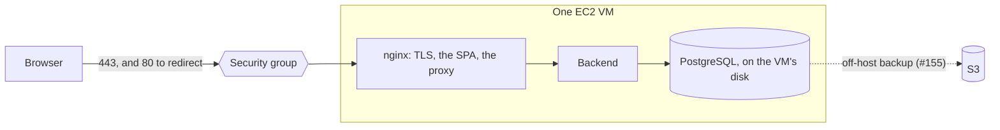

# ADR-086: The first deployment is one EC2 VM running the compose stack, from a file of its own

- **Status:** Accepted
- **Date:** 2026-11-04
- **Scope:** Where UpHealther first runs, and what that settles. This record and five status lines. Nothing
  is deployed by it, and no code or configuration changes.
- **Issue:** [#151](https://github.com/NaimElijah/UpHealther/issues/151), under the epic
  [#198](https://github.com/NaimElijah/UpHealther/issues/198).
- **Related:** [#430](https://github.com/NaimElijah/UpHealther/issues/430) builds the VM and
  [#429](https://github.com/NaimElijah/UpHealther/issues/429) the production compose file.
  [ADR-085](ADR-085-the-jar-creates-no-account-of-its-own.md) and
  [ADR-042](ADR-042-the-jar-carries-no-jwt-signing-key.md) each argued from Fargate; their status lines
  now say what replaces that.

## Context

UpHealther has never run anywhere but a developer's machine. #151 asked where it should first run, and
offered three options: one VM running the compose stack, which it recommended; a platform running the two
images, with a managed PostgreSQL; and Kubernetes, which it rejected.

On 2026-10-12 the owner chose the second, on AWS: ECS on Fargate, one task, behind an Application Load
Balancer, with RDS. That answer was a comment on #151, with no reason recorded. No ADR followed it, and #198's
sub-issues were written against it.

#151's remaining work was this record, with a priced estimate. Nobody had priced either option until
2026-11-04. The VM came out at about a quarter of the platform's bill, as *The estimate* below shows, and the
owner reversed the choice that day: **the bill matters more before there are any users.**

The forces:

- **There are no users and no revenue yet**, and the platform costs $1,030-1,340 a year more.
- **The platform would buy no uptime.** The system runs exactly one instance (requirements §5.3,
  [ADR-017](ADR-017-an-in-process-fixed-window-rate-limit-per-client-address.md)). So the one task deploys
  stop-then-start, and every deploy is an outage either way (#207).
- **What the platform does buy is real:** a database that outlives the host, with managed backups, and nobody
  patching an operating system or renewing a certificate. On a VM, all of that is the owner's.
- **The instance will hold strangers' health-behaviour data** (FR-1, #199).
- **The code already fits a VM.** nginx is written to be the first hop, so its address and scheme handling
  hold as they are. The platform needed `nginx.conf` re-derived for a load balancer (#208).
- **`docker-compose.yml` cannot be the deployment's file.** See *A production file of its own*.

## Decision

**UpHealther first runs on one AWS EC2 VM, running the compose stack from a production file of its own.** It
is public with open registration (FR-1), in one production environment, built with Terraform.

The owner chose the VM, the provider, and that the reason is cost. The rest of this section is what follows
from that, and is recorded here because #151 asked this record to settle it.

- **PostgreSQL stays on the VM,** in its container, on a named volume, as #151's option described. One disk
  holds all the data.
- **Off-host backups are a launch requirement,** because nothing else now provides them. #155 builds them, and
  the instance must not open to the public before a restore has been drilled.
- **nginx stays the first hop and terminates TLS itself,** with Let's Encrypt certificates mounted read-only
  and renewed on a timer. #209 chooses the challenge type and the HSTS values. Let's Encrypt is a new external
  dependency: it replaces ACM, which has no load balancer to attach to here. It costs nothing and adds no
  library to the build. #209 names the client that renews.
- **Only 80 and 443 are reachable,** enforced by an AWS security group. A host firewall would not do it:
  Docker's iptables rules bypass one (`docker-compose.yml:17-18`).
- **There is no inbound SSH and no key pair.** A person reaches the host through SSM Session Manager, which
  needs no open port and leaves a CloudTrail record.
- **The instance has an IAM role instead of a stored AWS key,** for the backup bucket now and for Bedrock
  (#257) when a feature needs it. #430 requires IMDSv2 with a hop limit of 1, so a container cannot read the
  role's credentials.
- **Secrets are in a root-only env file on the host.** #212 settles how they get there and how each rotates.
- **Logs stay in `docker logs`, with rotation on every service.** Rotation is therefore the audit trail's
  retention ([ADR-011](ADR-011-audit-as-a-log-stream.md)), and #217 sets the numbers.
- **The region stays #202's,** and the domain #209's. The estimate prices two regions so that neither is prejudged, and the
  choice between them moves the VM's bill by under a dollar a month.

### A production file of its own

#151 said to layer an override on `docker-compose.yml`. That file has changed since, and layering is no longer
safe. It gives `JWT_SECRET` a published default (`:63`), gives both database passwords published defaults
(`:8`, `:14`), and names and mounts the demo account's seed (`:69`, `:93`). Compose merges, so an override
would have to reset each of those, and forgetting one would put a published credential in production with no
error.

So production runs from a standalone file (#429), never layered on the base, that:

- gives every secret `${VAR:?}`, so a missing one stops the stack from starting;
- names no Flyway location and mounts no seed;
- has no `build:`, and pulls images pinned by version (#154);
- publishes only nginx.

**The VM holds no checkout of the repository.** It holds that file, the env file and the certificates. So the
seed is not on its disk to be mounted, which replaces the protection ADR-085 drew from a Fargate task being
unable to bind-mount a repository directory. `docker-compose.yml` stays the local stack and nothing else.

### The estimate

US dollars per month on 730 hours, on demand, with no free tier or credits. It is a snapshot: the prices move,
and this record will not. The unit prices were read on 2026-11-04 from AWS's public price lists, at
`https://pricing.us-east-1.amazonaws.com/offers/v1.0/aws/<service>/current/<region>/index.json`.

| Option | Frankfurt (`eu-central-1`) | Tel Aviv (`il-central-1`) |
|---|---|---|
| **One EC2 VM** | **25.07 to 42.59** | **25.44 to 42.88** |
| Fargate + ALB + RDS, with a NAT gateway | 110.93 to 154.04 | 111.18 to 157.05 |
| The same with no NAT gateway | 72.71 to 115.04 | 74.13 to 119.25 |

The Frankfurt bills, low to high:

| The VM | Low | High | | The platform | Low | High |
|---|---|---|---|---|---|---|
| Instance, `t3.small` to `t3.medium` | 17.52 | 35.04 | | NAT gateway, 5 to 20 GB | 38.22 | 39.00 |
| 30 GB `gp3` | 2.86 | 2.86 | | Fargate, 0.5 vCPU and 1 GB to 1 vCPU and 2 GB | 20.72 | 41.45 |
| 10 GB of snapshots | 0.54 | 0.54 | | ALB, 0.1 to 1 LCU | 20.29 | 25.55 |
| One public IPv4 address | 3.65 | 3.65 | | RDS, `db.t4g.micro` to `small`, 20 GB | 16.61 | 29.75 |
| One Route 53 zone | 0.50 | 0.50 | | Three public IPv4 addresses | 10.95 | 10.95 |
| | | | | Logs, 1 to 5 GB ingested, three months kept | 0.73 | 3.64 |
| | | | | 15 alarms | 1.50 | 1.50 |
| | | | | Three secrets | 1.20 | 1.20 |
| | | | | Route 53 zone, and 2 to 5 GB in ECR | 0.70 | 1.00 |

The unit prices behind them:

| Item | Frankfurt | Tel Aviv |
|---|---|---|
| `t3.small`, `t3.medium`, per hour | 0.024, 0.048 | 0.024, 0.0479 |
| EBS `gp3`, snapshot, per GB-month | 0.0952, 0.054 | 0.1056, 0.06 |
| Public IPv4 address, per hour | 0.005 | 0.005 |
| ALB per hour, LCU per hour | 0.027, 0.008 | 0.02646, 0.0084 |
| NAT gateway per hour, per GB | 0.052, 0.052 | 0.0504, 0.0504 |
| Fargate vCPU, GB, per hour | 0.04656, 0.00511 | 0.0518144, 0.0056896 |
| RDS `db.t4g.micro`, `db.t4g.small`, per hour | 0.019, 0.037 | 0.018, 0.037 |
| RDS `gp3`, per GB-month | 0.137 | 0.153 |
| Logs ingested per GB, kept per GB-month | 0.63, 0.0324 | 0.50, 0.03 |
| Alarm, secret, Route 53 zone, per month | 0.10, 0.40, 0.50 | 0.10, 0.40, 0.50 |
| ECR, per GB-month | 0.10 | 0.10 |

**What is assumed.** Every size is a guess until #220 measures one, and a 2 GB VM may be too small for
PostgreSQL plus the JVM. The traffic, the log volume and the alarm count are guesses too.

**What is left out.** Outbound data, assumed to stay inside AWS's free allowance (**Not verified**). The backup,
CloudTrail and Terraform state buckets. GuardDuty, if #202 enables it. The domain's registration.

### What this settles for each record

| Record | What it settles | Its note |
|---|---|---|
| [ADR-017](ADR-017-an-in-process-fixed-window-rate-limit-per-client-address.md) | "the moment a second instance is run" did not fire: one VM, one backend | Its status line, here |
| [ADR-020](ADR-020-the-server-keeps-time-in-utc.md) | "a single region outside UTC" has not fired: where the users are stays open | Its status line, here |
| [ADR-042](ADR-042-the-jar-carries-no-jwt-signing-key.md) | "Production is ECS on Fargate" is replaced by the file above | Its status line, here |
| [ADR-046](ADR-046-dependabot-proposes-weekly-updates-into-dev.md) | "a public deployment" fires: secret scanning's other features | Its status line, here; #431 does the work |
| [ADR-085](ADR-085-the-jar-creates-no-account-of-its-own.md) | "`docker-compose.yml` is used to deploy anything" did not fire, and its Fargate argument is replaced | Its status line, here |
| [ADR-018](ADR-018-a-content-security-policy-with-a-hashed-inline-boot-script.md) | "putting this behind TLS" fires; HSTS moves with nginx's TLS | #209's own ADR |
| [ADR-011](ADR-011-audit-as-a-log-stream.md) | The audit trail's retention is the rotation | #217's own ADR |
| [ADR-012](ADR-012-metrics-through-a-prometheus-scrape-endpoint.md) | "a deployment somebody is paged for" fires, and what scrapes it is #218's. Its management-port trigger does not fire: production publishes no API port | #218's own ADR |
| [ADR-007](ADR-007-request-correlation-through-micrometer-tracing.md) | "somewhere to export to" is #218's. [ADR-067](ADR-067-trace-context-is-accepted-only-from-trusted-hops.md) already answered its inbound-header trigger | #218's own ADR |
| [ADR-026](ADR-026-a-scheduled-run-that-threw-is-logged-in-full.md), [ADR-027](ADR-027-hibernates-sql-exception-logger-is-turned-off.md) | "Logs leave the operator's control" does not fire: they stay in `docker logs` | None |
| [ADR-069](ADR-069-the-compose-backend-connects-as-a-role-that-owns-its-database.md), [ADR-070](ADR-070-nginx-throttles-the-websocket-handshake-per-client-address.md) | "a managed database" and "a load balancer goes in front of nginx" do not fire | None |

## Consequences

**Easier:**

- **The bill is $25-43 a month instead of $111-154.**
- **The code stays as written.** nginx stays the first hop, and the backend trusts its one pinned address, so
  #208's load balancer work is no longer needed. That the client's real address survives Docker's published port
  on a Linux host is **Not verified**; #429 must show it, because NFR-43's rate limit rests on it.
- **Much of #198 shrinks or goes:** no RDS (#206), no ECS service (#207), no load balancer hop (#208).

**Harder:**

- **The owner operates a host:** operating system patches and their reboots, certificate renewal, backups, and
  restore drills. #221's runbooks matter more for it, and a mistake in any of them is the owner's to find.
- **One disk holds all the data.** Until #155's backups exist and a restore has worked, losing the disk loses
  every user's records. This is why opening to the public waits for them.
- **A host failure is an outage until the host is rebuilt** from Terraform and the backup. Nothing replaces it
  automatically.
- **Every deploy is still a brief outage.** `docker compose up` replaces the containers, and every socket
  drops (#211).
- **The attack surface now includes a host.** #224's threat model has to cover a VM with a public address, most
  of which the managed platform would have taken on.
- **Sizing is one choice for everything.** PostgreSQL, the JVM and nginx share one instance's memory and
  credit balance, so a burst in one starves the others, until #220 measures it.

## Alternatives considered

**Fargate + ALB + RDS, the choice of 2026-10-12.** It removes the host and gives a database that outlives it, at
$111-154 a month, for no extra uptime. Rejected on cost, before there are users to justify it. **Revisit** on
the triggers below. #198's sub-issues describe it in detail, so they stay readable as that design.

**The same with no NAT gateway** (#205's option 3), at $73-115. The task then sits in a public subnet with one
security group in the way, and it still costs about three times the VM. Rejected for the same reason.

**RDS beside the VM.** About $17-30 a month more, for managed backups and a database that survives losing the
host. It is the cheapest single step up from this decision, and it needs configuration rather than code. Not
chosen because cost was the reason for the VM. **Revisit first** if the off-host backups prove unreliable, or
once real users' data is worth more to the owner than that line on the bill.

**Lightsail,** at about $12-24 a month plus backups, for 2 GB to 4 GB bundles. It halves the bill. As far as we
know it has no IAM role on the instance (**Not verified**), which would put a stored AWS key on the host for
backups and Bedrock, the credential this record removes. Rejected.

**A provider other than AWS.** Possibly cheaper still, though no price could be read to compare. It keeps an AWS
account for Bedrock (#257) anyway, with a stored key, and loses the role and the disk snapshots. Rejected.

**A TLS proxy in front of nginx,** Caddy for example, with automatic certificates. It would make renewal someone
else's problem, but nginx would stop being the first hop. That breaks the client address and the scheme nginx
writes (NFR-43), which is the rewrite the VM avoids, and adds a component to keep patched. Rejected. **Revisit**
if certificate renewal on nginx proves fragile.

**An override layered on `docker-compose.yml`,** which #151 proposed. Rejected above, under *A production file of
its own*.

**Kubernetes.** Rejected in #151: it assumes more than one instance. **Revisit** alongside a second instance.

**A staging environment.** It doubles the bill to catch what CI and the end-to-end suite do not (#198).
**Revisit** after a production deploy breaks real users in a way the pipeline could not have caught.

**More than one instance.** §5.3 rules it out. The STOMP broker, the sign-in limiter and the socket registry
([ADR-054](ADR-054-a-session-that-ends-closes-its-open-sockets.md)) live in one process's memory, and five scheduled
methods run unlocked. **Revisit** when load or an availability target needs it, at which point those four changes
land together, and the VM stops being the right shape.

## When to revisit

- **Running the host costs more of the owner's time than the platform costs in money.** This is #151's own
  trigger, and the difference to weigh is the $1,030-1,340 a year above.
- **An incident is caused by operating the host:** a missed patch, an expired certificate, a failed restore. One
  is enough to reconsider.
- **There is an availability target** that one host and a rebuild cannot meet.
- **A second instance is needed,** as above.
- **Real users' data outgrows the risk the owner accepted here,** which starts with RDS beside the VM.
- **A deployment is ever made through `docker-compose.yml`.** It must not be.
