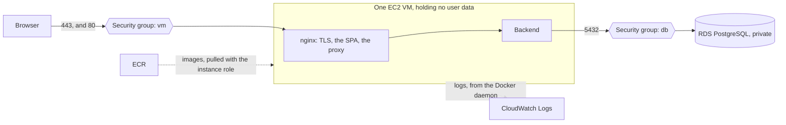

# ADR-086: The first deployment is one EC2 VM running compose from a file of its own, with the database on RDS

- **Status:** Accepted
- **Date:** 2026-11-04
- **Scope:** Where UpHealther first runs, and what that settles. This record, nine status lines and one comment
  in `frontend/nginx.conf`. Nothing is deployed by it, and no behaviour changes.
- **Issue:** [#151](https://github.com/NaimElijah/UpHealther/issues/151), under the epic
  [#198](https://github.com/NaimElijah/UpHealther/issues/198).
- **Related:** [#430](https://github.com/NaimElijah/UpHealther/issues/430) builds the VM and
  [#429](https://github.com/NaimElijah/UpHealther/issues/429) the production compose file.
  [ADR-085](ADR-085-the-jar-creates-no-account-of-its-own.md) and
  [ADR-042](ADR-042-the-jar-carries-no-jwt-signing-key.md) each argued from Fargate; their status lines
  now say what replaces that.

## Context

UpHealther has never run anywhere but a developer's machine. #151 asked where it should first run, and offered
three options: one VM running the compose stack with PostgreSQL on the same host, which it recommended; a
platform running the two images, with a managed PostgreSQL; and Kubernetes, which it rejected.

On 2026-10-12 the owner chose the second, on AWS: ECS on Fargate, one task, behind an Application Load Balancer,
with RDS. That answer was a comment on #151, with no reason recorded. No ADR followed it, and #198's sub-issues
were written against it.

#151's remaining work was this record, with a priced estimate, and nothing had been priced. On 2026-11-04 the
options were priced and the design reviewed, and the owner kept RDS and replaced the rest with one VM, at about
half the bill.

The forces (dollar figures here and below are Frankfurt's unless a table says otherwise):

- **There are no users and no revenue yet,** and the platform costs $800-915 a year more than this decision.
- **Losing strangers' health data is the worst outcome** (FR-1, #199). With PostgreSQL on the VM, one disk holds
  it, along with backups a compromised host could overwrite. RDS takes it off the host for about $200-355 a year.
- **What the rest of the platform buys is real, and this gives it up.** If the machine dies, ECS replaces the
  task with nobody awake, while a VM stays down until rebuilt. An ALB can carry AWS WAF. There is no host to
  patch. It does not buy uptime on a deploy: the system runs one instance (requirements §5.3,
  [ADR-017](ADR-017-an-in-process-fixed-window-rate-limit-per-client-address.md)), so a deploy is stop-then-start
  either way (#207).
- **nginx is written to be the first hop,** so its client address and scheme handling carry over, if Docker's
  published port preserves the address, which is **Not verified** (see *Consequences*). The platform needed them
  re-derived for a load balancer (#208).
- **`docker-compose.yml` cannot be the deployment's file.** See *A production file of its own*.

## Decision

**UpHealther first runs on one AWS EC2 VM, running nginx and the backend from a compose file of its own, with
PostgreSQL on RDS, images in ECR and logs in CloudWatch.** It is public with open registration (FR-1), in one
production environment, built with Terraform.

### What the owner decided

One VM over the platform, for the bill. RDS over PostgreSQL on the VM. CloudWatch Logs over logs that stay on the
VM. ECR over GHCR. The review points under *When to revisit*. The rest of the 2026-10-12 answer stands: AWS, public,
production only, Terraform.

### Defaults this record sets

The owner did not choose these one by one. #151 asked this record to settle them, and each can be challenged on
its own.

- **The network has no NAT gateway.** The VM sits in a public subnet with an Elastic IP, and RDS in private subnets
  (#205). Group `db` admits 5432 from group `vm` alone.
- **The first deployment is gated.** Until every launch blocker in #199 is closed, including a restore drilled under
  #155, group `vm` admits 443 from the owner's address only. Port 80 stays open for the redirect and for #209's
  certificate challenge if it needs one.
- **nginx terminates TLS itself,** with Let's Encrypt certificates mounted read-only and renewed on a timer. Let's
  Encrypt is a new external dependency: it replaces ACM, which has no load balancer to attach to here. It costs
  nothing and adds no library to the build.
  - **The TLS config lives in the repository and in the image,** beside today's plain one, and is chosen at start.
    So a test reads what production runs, the local stack and `npm run test:images` still start with no
    certificate, and CI starts the TLS config with a throwaway certificate.
  - #209 builds that, along with the challenge path, the first certificate, the reload after a renewal, a health
    path that does not redirect, the HSTS values, and an expiry check.
- **Only group `vm` decides what is reachable.** A host firewall would not do: Docker's iptables rules bypass one
  (`docker-compose.yml:17-18`).
- **There is no inbound SSH and no key pair.** A person reaches the host through SSM Session Manager. CloudTrail
  records that a session started, not what was typed, so #430 turns on session logging. `ssm-user` has passwordless
  sudo, so a session can read the env file below.
- **The instance has an IAM role instead of a stored AWS key,** for processes on the host: SSM, ECR pull, and the
  Docker daemon writing logs. It has no RDS rights, so a compromised host cannot delete the database or its backups.
  - #430 requires IMDSv2 with a hop limit of 1, so that a container should not get the role's credentials. That is
    **Not verified** on this stack, and #430 must show it.
  - Bedrock (#257) is undecided and is not served by this role: the backend is a container. A feature that needs it
    decides how the backend gets credentials, because raising the hop limit would hand the role to nginx too.
- **Secrets are in a root-only env file on the host.** RDS keeps its own master password in Secrets Manager (#206).
  #212 settles how the rest get there and how each rotates.
- **Images are pinned by digest.** A tag can be pushed again with different bytes (#154).
- **The instance's CPU credits are `standard`,** so a burst throttles rather than bills (#430).
- **The region stays #202's,** and the domain #209's. The estimate prices two regions so that neither is prejudged.

### A production file of its own

#151 said to layer an override on `docker-compose.yml`. That file has changed since, and layering is no longer safe.
It gives `JWT_SECRET` a published default (`:63`), gives the database passwords published defaults (`:8`, `:14`,
`:59`), and names and mounts the demo account's seed (`:69`, `:93`). Compose merges, so an override would have to
reset each of those, and forgetting one would put a published credential in production with no error.

So production runs from a standalone file (#429), never layered on the base, that:

- runs nginx and the backend, and no database;
- gives every secret `${VAR:?}`, so a missing one stops the stack from starting;
- names no Flyway location and mounts no seed;
- has no `build:`, and pulls images from ECR by digest;
- publishes only nginx.

**The VM holds no checkout of the repository.** It holds that file, the env file and the certificates. So the seed is
not on its disk to be mounted, which replaces the protection ADR-085 drew from a Fargate task being unable to
bind-mount a repository directory. Deploying anything through `docker-compose.yml` stays forbidden: it remains the
local stack and nothing else.

### The estimate

US dollars per month on 730 hours, on demand, with no free tier or credits. It is a snapshot: the prices move, and
this record will not. The unit prices were read on 2026-11-04 from AWS's public price lists, at
`https://pricing.us-east-1.amazonaws.com/offers/v1.0/aws/<service>/current/<region>/index.json`. Totals are computed
before rounding, so a column can differ from its total by a cent.

| Option | Frankfurt (`eu-central-1`) | Tel Aviv (`il-central-1`) |
|---|---|---|
| **This decision** | **43.96 to 77.83** | **43.73 to 77.70** |
| PostgreSQL on the VM instead of RDS, with 10 GB of snapshots | 27.49 to 48.22 | 27.73 to 47.84 |
| Fargate + ALB + RDS, with a NAT gateway | 110.93 to 154.04 | 111.18 to 157.05 |
| The same with no NAT gateway | 72.71 to 115.04 | 74.13 to 119.25 |

This decision's bill in Frankfurt:

| Line | Low | High |
|---|---|---|
| Instance, `t3.small` to `t3.medium` | 17.52 | 35.04 |
| RDS, `db.t4g.micro` to `small`, 20 GB | 16.61 | 29.75 |
| One public address, an Elastic IP assumed to bill at the in-use rate | 3.65 | 3.65 |
| 30 GB `gp3` | 2.86 | 2.86 |
| 15 alarms | 1.50 | 1.50 |
| Logs, 1 to 5 GB ingested, three months kept | 0.73 | 3.64 |
| Route 53 zone | 0.50 | 0.50 |
| One secret, RDS's master password | 0.40 | 0.40 |
| ECR, 2 to 5 GB | 0.20 | 0.50 |

The platform's bill in Frankfurt has the same RDS, logs, alarms, Route 53 and ECR lines, plus a NAT gateway (38.22 to
39.00, for 5 to 20 GB), Fargate (20.72 to 41.45, for 0.5 vCPU and 1 GB to 1 vCPU and 2 GB), an ALB (20.29 to 25.55, for
0.1 to 1 LCU), three public addresses (10.95) and three secrets (1.20) in place of the one above.

The unit prices behind them:

| Item | Frankfurt | Tel Aviv |
|---|---|---|
| `t3.small`, `t3.medium`, per hour | 0.024, 0.048 | 0.024, 0.0479 |
| EBS `gp3`, snapshot, per GB-month | 0.0952, 0.054 | 0.1056, 0.06 |
| Public IPv4 address, per hour | 0.005 | 0.005 |
| RDS `db.t4g.micro`, `db.t4g.small`, per hour | 0.019, 0.037 | 0.018, 0.037 |
| RDS `gp3`, per GB-month | 0.137 | 0.153 |
| ALB per hour, LCU per hour | 0.027, 0.008 | 0.02646, 0.0084 |
| NAT gateway per hour, per GB | 0.052, 0.052 | 0.0504, 0.0504 |
| Fargate vCPU, GB, per hour | 0.04656, 0.00511 | 0.0518144, 0.0056896 |
| Logs ingested per GB, kept per GB-month | 0.63, 0.0324 | 0.50, 0.03 |
| Alarm, secret, Route 53 zone, per month | 0.10, 0.40, 0.50 | 0.10, 0.40, 0.50 |
| ECR, per GB-month | 0.10 | 0.10 |

**What is assumed.** Every size is a guess until #220 measures one. The traffic, the log volume and the alarm count
are guesses too.

**What is left out.** Outbound data, assumed to stay inside AWS's free allowance (**Not verified**). The CloudTrail
and Terraform state buckets. GuardDuty, if #202 enables it. RDS backup storage past what is free. The domain's
registration. T3 surplus credits, which `standard` mode avoids: left on the default Unlimited mode, sustained CPU would
add up to 2 x 0.8 x 730 x $0.05 = $58.40 a month in Frankfurt.

### What this settles for each record

| Record | What it settles | Its note |
|---|---|---|
| [ADR-017](ADR-017-an-in-process-fixed-window-rate-limit-per-client-address.md) | "the moment a second instance is run" did not fire: one VM, one backend | Its status line, here |
| [ADR-020](ADR-020-the-server-keeps-time-in-utc.md) | "a single region outside UTC" has not fired: where the users are stays open, for #179 and #202 | Its status line, here |
| [ADR-026](ADR-026-a-scheduled-run-that-threw-is-logged-in-full.md), [ADR-027](ADR-027-hibernates-sql-exception-logger-is-turned-off.md) | "Logs leave the operator's control" fires: they are "retained beyond `docker logs`". #436 does the work | Their status lines, here |
| [ADR-042](ADR-042-the-jar-carries-no-jwt-signing-key.md) | "Production is ECS on Fargate" is replaced by the file above | Its status line, here |
| [ADR-046](ADR-046-dependabot-proposes-weekly-updates-into-dev.md) | "a public deployment" fires: secret scanning's other features. #431 does the work | Its status line, here |
| [ADR-069](ADR-069-the-compose-backend-connects-as-a-role-that-owns-its-database.md), [ADR-072](ADR-072-every-migration-bounds-its-lock-wait.md) | "a managed database" fires. #206 decides the application's role and whether migrations get their own | Their status lines, here |
| [ADR-085](ADR-085-the-jar-creates-no-account-of-its-own.md) | "`docker-compose.yml` is used to deploy anything" did not fire, and its Fargate argument is replaced | Its status line, here |
| [ADR-018](ADR-018-a-content-security-policy-with-a-hashed-inline-boot-script.md) | "putting this behind TLS" fires. HSTS moves with nginx's TLS, and #433 stops Spring sending its own | #209's own ADR |
| [ADR-011](ADR-011-audit-as-a-log-stream.md) | The audit trail's retention is the log group's, not `docker logs`' | #217's own ADR |
| [ADR-012](ADR-012-metrics-through-a-prometheus-scrape-endpoint.md) | "a deployment somebody is paged for" fires, and what scrapes it is #218's. Its management-port trigger does not fire: production publishes no API port | #218's own ADR |
| [ADR-007](ADR-007-request-correlation-through-micrometer-tracing.md) | "somewhere to export to" is #218's. [ADR-067](ADR-067-trace-context-is-accepted-only-from-trusted-hops.md) already answered its inbound-header trigger | #218's own ADR |
| [ADR-065](ADR-065-the-backend-hardened-after-scan-05.md) | "a rolling deploy runs both releases at once" does not hold, since a deploy here stops the old first. Its two-step column drop stays right for a rollback | None |
| [ADR-070](ADR-070-nginx-throttles-the-websocket-handshake-per-client-address.md) | "a load balancer goes in front of nginx" does not fire. Its objection to `limit_conn` is weighed again in #434 | None |

### What each open issue now does

Each gets a comment saying so, and its body is corrected when it is picked up.

| Issue | After this record |
|---|---|
| #202, #203, #214 | Stand. #203 has fewer resources to create |
| #204 | Stands, with the deploy role pushing to ECR and sending one SSM command rather than updating ECS |
| #205 | Rescoped: public subnets for the VM, private for RDS, groups `vm` and `db`, no NAT gateway |
| #206 | Stands: RDS. Its source group is `vm`, not `task` |
| #207, #208 | Closed as not planned. #207's ECR parts move to #154, the rest to #429 and #430. There is no load balancer hop |
| #209 | Rescoped: nginx's TLS with Let's Encrypt rather than an ALB with ACM, and a CAA record |
| #210 | Its ALB premise goes. What remains is nginx's one-hour `/ws` timeout |
| #211 | Rescoped: `stop_grace_period` rather than `stopTimeout` and a target group's delay |
| #212 | Rescoped: the env file. A `$` in it silently corrupts a value, so values are hex |
| #213 | Stands, and its reason gets stronger: a shared kernel, not a task boundary. #429 depends on its items 1, 4 and 5 |
| #215 | Rescoped: SSM and `docker compose up` rather than ECS |
| #216 | Stands: RDS snapshots. Its ECS rollback reasoning does not apply |
| #217 | Stands: CloudWatch log groups, with the `awslogs` driver on the VM |
| #218 | Rescoped: no task to put a sidecar in, so any collector is a compose service sharing the VM's memory |
| #219 | Rescoped: RDS alarms and the log filter stay, ALB and ECS alarms go, and the VM's status, disk, memory and certificate are added |
| #220, #221 | Rescoped from a task to a VM and RDS. #221 gains a rebuild runbook |
| #154 | Publishes to ECR, as its 2026-10-12 comment proposed, with immutable tags and scanning |
| #155 | Its RDS path applies, and #199's launch blockers gain it |

## Consequences

**Easier:**

- **The bill is $44-78 a month instead of $111-154.**
- **The host holds no user data,** so rebuilding it is a Terraform apply and a deploy, and a drill is cheap. A compromised
  host cannot reach the database's backups.
- **The application's code stays as written,** and so does nginx's first-hop handling, so #208's load balancer work is
  not needed. That the client's real address survives Docker's published port on a Linux host is **Not verified**. NFR-42,
  NFR-43, NFR-59 and ADR-070's throttle all rest on it, and `frontend/nginx.conf:23-25` records loopback connections arriving
  from Docker's gateway. #429 must show it. If it fails, one script's failed sign-ins lock everyone out, and a hop in
  front of nginx is back on the table.

**Harder:**

- **The owner operates a host:** operating system patches and their reboots, moving the Docker pin when a container
  runtime fix ships, certificate renewal and its expiry alarm, and #221's runbooks. A mistake in any of them is the owner's to
  find.
- **A dead host is an outage until it is rebuilt,** and nothing replaces it automatically. Every deploy is an outage too: its
  length is unmeasured, and every socket drops (#211).
- **nginx gains TLS.** The image needs a second configuration, port 80 needs a health path and a challenge path, and #433 has
  to stop the backend sending a year of HSTS the moment it sees HTTPS.
- **Nothing stands in front of nginx.** One anonymous address can hold all its connections today (#434), AWS WAF does not attach
  to an EC2 instance, and the VM's single public process carries the whole site.
- **The attack surface now includes a host.** The containers share its kernel, so #213's non-root images become a precondition
  of the first deploy, and #224's threat model has to cover a VM with a public address.
- **A session on the host can read every secret on it,** and only session logging says what was done.
- **Logs now outlive the container,** so what they may contain matters (#436). A signed-in account can also write without limit
  until #435, up to RDS's storage ceiling.
- **nginx and the JVM share one instance's memory and CPU credits,** so a burst in one throttles the other, until #220 measures it.

## Alternatives considered

**Fargate + ALB + RDS, the choice of 2026-10-12,** at $111-154. It recovers by itself from a dead machine, has no host to patch,
and can carry AWS WAF. It buys no uptime on a deploy. Rejected on cost, before there are users to justify it. **Revisit** on the
triggers below. Closed #207 and #208 keep its detail.

**The same with no NAT gateway** (#205's option 3), at $73-115. It is still about one and a half times this decision. Rejected for
the same reason. **Revisit** with the platform, as the cheaper way in.

**PostgreSQL on the VM,** #151's option, at $27-48. It saves about $200-355 a year. One disk then holds every user's records,
so the owner would have to build, lock and drill off-host backups that a compromised host cannot overwrite, and a host failure
loses data rather than time. Rejected because that is the worst outcome here. **Revisit** only if the instance ends up serving
nobody but the owner.

**Logs only in `docker logs`.** Free, and nothing leaves the machine. But a deploy deletes them: run, one recreate took a container's
audit lines from 1 to 0. One anonymous client also evicted them in about a minute, because one message writes 1,170 ERROR lines
(#382). Rejected, because a trail that a release erases is not a trail. **Revisit** if logs become a large share of the bill, as a
cheaper store rather than fewer logs.

**GHCR, the plan in #154's body.** Free, but outside Actions it accepts only a personal access token (classic), stored on the host,
long-lived, and a person's. Rejected. **Revisit** if hosting leaves AWS.

**Lightsail,** at about $12-24 a month in Frankfurt plus backups (it has no Tel Aviv price list). As far as we know it has no IAM
role on the instance (**Not verified**), which would put stored AWS keys on the host for ECR and CloudWatch. Rejected. **Revisit** if
that proves false.

**A provider other than AWS.** Possibly cheaper still, though no price could be read to compare. RDS, ECR and CloudWatch would then
need stored keys or replacing. Rejected. **Revisit** if the project stops using AWS services.

**A TLS proxy in front of nginx,** Caddy for example, with automatic certificates. It would make renewal someone else's problem, but
nginx would stop being the first hop, which is the rewrite this decision avoids, and it adds a component to keep patched. Rejected.
**Revisit** if certificate renewal on nginx proves fragile, or #429's client address proof fails.

**A load balancer or CDN in front of nginx, for AWS WAF.** It costs at least the ALB's $20 a month and ends nginx's first-hop role.
Rejected for now. **Revisit** if a real attack gets past #434's limits.

**An override layered on `docker-compose.yml`,** which #151 proposed. Rejected above. **Revisit** if the base file ever loses its
published defaults and its seed.

**Inbound SSH.** An open port and a stored key, for what SSM gives with neither. Rejected. **Revisit** if SSM ever locks the owner
out during a real incident.

**Secrets Manager or Parameter Store for every secret,** the answer in #151's table. It would avoid a file on the host, for a fetch at
start and more role rights. Not chosen for now, and #212 can still choose it. **Revisit** when a second person needs host access.

**Kubernetes.** Rejected in #151: it assumes more than one instance. **Revisit** alongside a second instance.

**A staging environment.** It doubles the bill to catch what CI and the end-to-end suite do not (#198). **Revisit** after a production
deploy breaks real users in a way the pipeline could not have caught.

**More than one instance.** §5.3 rules it out. The STOMP broker, the two rate limiters and the socket registry
([ADR-054](ADR-054-a-session-that-ends-closes-its-open-sockets.md)) live in one process's memory, and five scheduled methods run
unlocked (#437 puts that list in one place). **Revisit** when load past #220's measured ceiling, or an availability target, needs it.
Those four changes then land together, and the VM stops being the right shape.

## When to revisit

- **100 accounts besides the owner's, the first revenue, or six months after opening to the public, whichever comes first.** This
  record's reason is the bill before there are users, so these end that reason. They call for a review, not a migration: read the bill
  against what the host has cost.
- **Host work costs more than the platform's difference,** about $200-230 a quarter. This is #151's own trigger, along with "when
  nobody is willing to own a host". The owner notes the hours at each review.
- **An incident is caused by operating the host:** a missed patch, an expired certificate, or a failed restore drill. One is enough.
- **There is an availability target** tighter than the rebuild time #430 measures.
- **#429's client address proof fails.**
- **An attack gets past #434's limits.**
