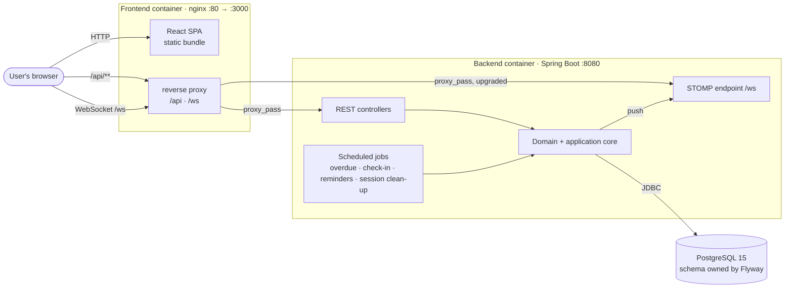
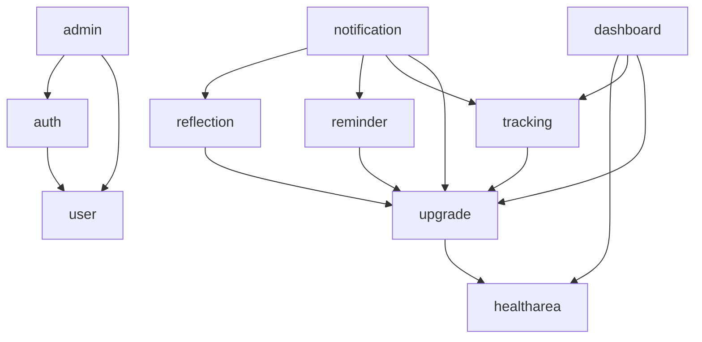
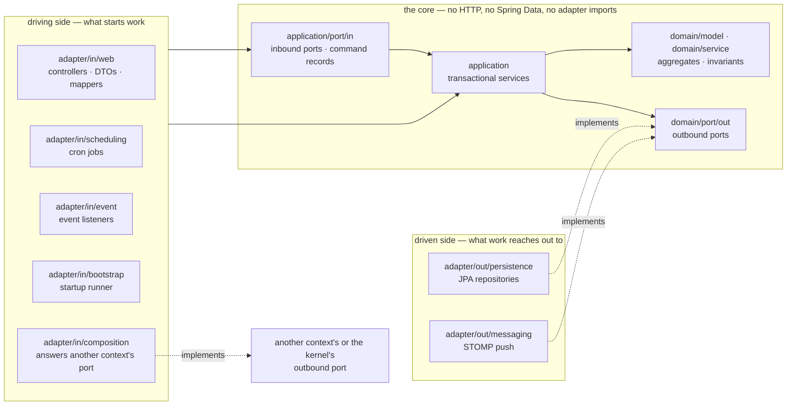
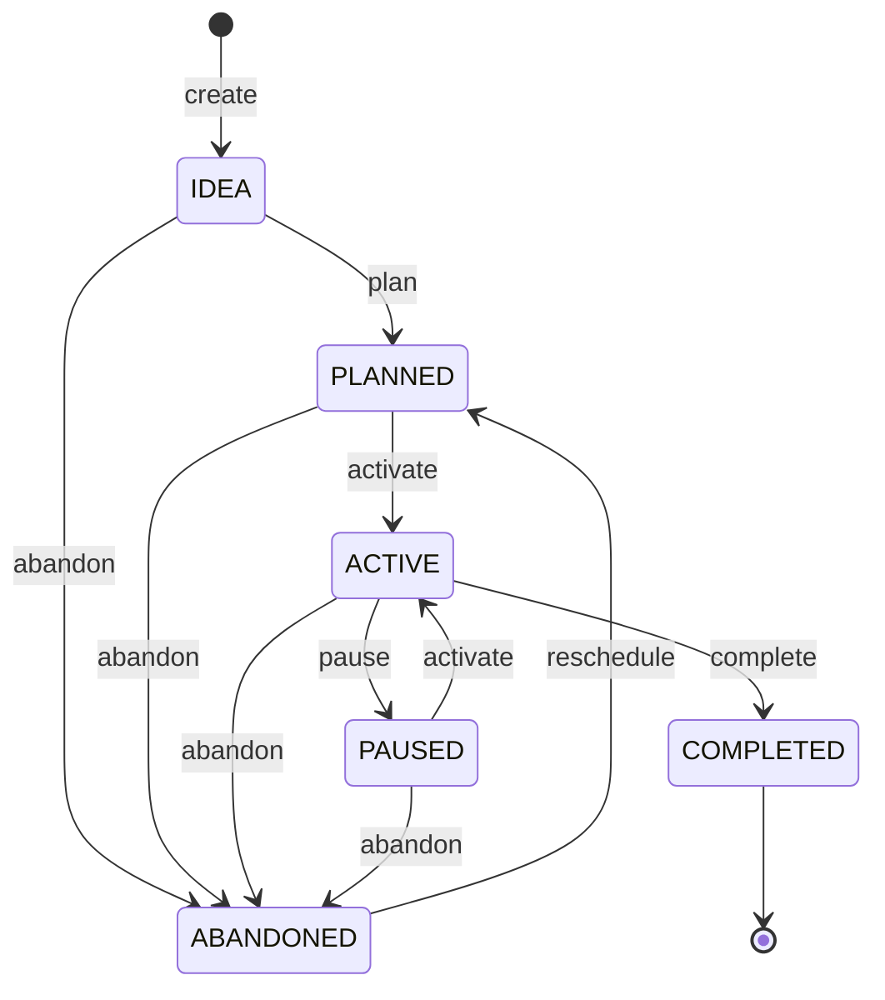
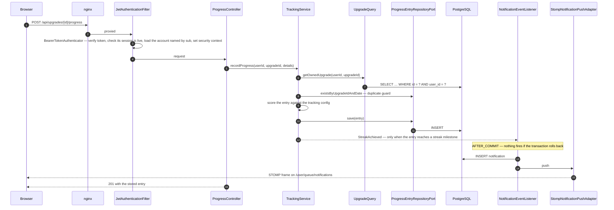
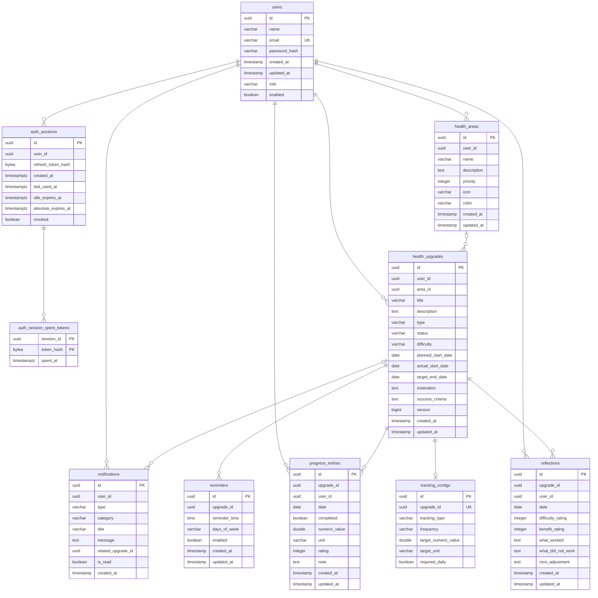

# Architecture diagrams

Seven views of UpHealther, ordered from the outside in: what the moving parts are, how the backend
is divided, how one division is shaped, what one of them contains, how its core object moves through
its life, how a request travels, and what is stored.

Read them in order and you have the system. For the prose that goes with them see
[`../architecture.md`](../architecture.md); for why any of it is shaped this way, see
[`../../ADRs/`](../../ADRs/).

> **Three of these are generated, not drawn.** The context map, the class diagram and the ER diagram
> are derived from the imports, the package layout and the Flyway migrations respectively, by
> [`generate.py`](generate.py). CI fails if the committed output stops matching the source, so a
> diagram here cannot quietly go out of date. The other four describe intent rather than structure,
> do not rot, and are written by hand.

---

## 1. System context

Three processes and a browser. There is no message broker, no cache and no third-party service —
every piece of state is in the one database, and every side effect is either a write to it or a
message pushed to a connected browser.



Same-origin by design: the browser only ever talks to the frontend's origin, and the proxy forwards
`/api` and `/ws` onward. In development the Vite dev server does the same job, so both sides behave
identically.

---

## 2. Bounded-context map

The backend is ten bounded contexts over a shared kernel. This graph is read off the `import`
statements — it is what the code does, not what anyone intended.

<!-- generated:context-map -->

<!-- /generated:context-map -->

`common` is excluded. It depends on no context, which `HexagonalArchitectureTest` fails the build over
([ADR-062](../../ADRs/ADR-062-the-shared-kernel-depends-on-no-bounded-context.md)), and every context
depends on it, so drawing it would add ten edges that say nothing. The absent edge is the interesting
one — `upgrade` does not point at `tracking`, even though
an upgrade's response carries its tracking configuration. Its one outgoing edge is to
`healtharea`, whose inbound port confirms an area is the caller's before an upgrade is filed under it. That inversion is
[ADR-002](../../ADRs/ADR-002-close-the-gap-between-the-described-and-enforced-architecture.md).

---

## 3. How to read a context

The contexts share one pattern, though not one shape: this is the full one, and the paragraph after
it names the contexts that leave parts out. Arrows run **inward**: adapters depend on the core, and
the core imports no adapter. The driven side is inverted — persistence and messaging *implement* ports
the core declares, rather than the core calling them.



The core is not free of frameworks. The entities in `domain/model` carry `jakarta.persistence`
mapping annotations, and the application services are Spring beans with `@Transactional`. The label
names only what ArchUnit forbids (see
[`../architecture.md`](../architecture.md#structural-decisions-not-visible-from-the-file-layout)).

A driving adapter starts work and does nothing else: it calls a use case, through an inbound port or
the context's own application service, and never an outbound port. A cron job times its run, and
reads the clock where the sweep needs a date; the sweep itself, with its rules and its writes, is an
application method.
`adapter/in/bootstrap` holds `AdminBootstrapRunner`, which runs once at startup and calls an application
service in the same way. `adapter/in/composition` differs: it sits on the driving side because
it calls its own context's inbound port, but what it does is implement an outbound port that another
context or the kernel declared. `tracking` answers `upgrade`'s `UpgradeTrackingSummaryPort`, `auth` the
kernel's `SessionStatusPort`, and `user` its `AccountCredentialsPort`. The rule covers outbound ports
under `domain` and `application` alike, and names three exceptions, with their reasons, in
`HexagonalArchitectureTest`: a composition adapter, to a port it implements and the records that port
returns; `SessionEndSocketListener`, to `LiveSocketPort`; and `UpgradeWebMapper`, to
`UpgradeTrackingSummaryPort` ([ADR-064](../../ADRs/ADR-064-the-backends-layering-rules-beyond-adr-002.md)).

This is not a convention anyone has to remember — `HexagonalArchitectureTest` fails the build on
every arrow that runs the wrong way. Not every context has every part, and
[ADR-002](../../ADRs/ADR-002-close-the-gap-between-the-described-and-enforced-architecture.md) and
`backend/CLAUDE.md` call that deliberate:

- `admin` and `dashboard` are two-layer: an application layer and driving adapters, with no domain
  and no driven side. `admin` owns no aggregate and orchestrates over `user` and `auth`; `dashboard`
  is a read model that persists nothing.
- `user` has no web adapter of its own: `auth`'s controller serves its account responses.
- `auth` has all three layers, with `AuthSession` as its aggregate, and orchestrates over `user` for
  identity. It adds `adapter/out/security` for signing access tokens and generating secrets, and
  `adapter/out/resource` for reading the common-password list the jar bundles.

---

## 4. Inside one context — `upgrade`

The core context, and the one worth reading in full: it owns `HealthUpgrade`, the aggregate whose
state machine the whole product is built around. The other full contexts follow the shape from §3.

Relations shown are **implements**, **extends**, and *holds a field of this type* — the composition
that reveals the wiring. Accessors and framework plumbing are left out on purpose; the interesting
content is which layer a type sits in and which way its arrows point.

Two things are therefore absent by construction, and neither means what it looks like. Dependencies on
`common` and on Spring are out of scope — `UpgradeService` also holds a `DomainEventPublisher` and a
`Clock`. And a type *constructed in a method* rather than held as a field draws no arrow, which is why
nothing connects `UpgradeBeansConfig` to `UpgradeSchedulingService` even though wiring that bean is the
only reason the class exists.

```mermaid
classDiagram
    direction LR

    %% ---- domain model ----
    class Difficulty {
        <<domain model · enum>>
    }
    class HealthUpgrade {
        <<domain model>>
    }
    class UpgradeStatus {
        <<domain model · enum>>
    }
    class UpgradeType {
        <<domain model · enum>>
    }

    %% ---- domain event ----
    class HealthUpgradeAbandoned {
        <<domain event>>
    }
    class HealthUpgradeActivated {
        <<domain event>>
    }
    class HealthUpgradeCompleted {
        <<domain event>>
    }
    class HealthUpgradeCreated {
        <<domain event>>
    }
    class HealthUpgradePaused {
        <<domain event>>
    }
    class HealthUpgradePlanned {
        <<domain event>>
    }
    class UpgradeOverdueDetected {
        <<domain event>>
    }

    %% ---- domain service ----
    class UpgradeSchedulingService {
        <<domain service>>
    }

    %% ---- outbound port ----
    class UpgradeRepositoryPort {
        <<outbound port>>
    }
    class UpgradeTrackingSummaryPort {
        <<outbound port>>
    }

    %% ---- port record ----
    class UpgradeTrackingSummary {
        <<port record>>
    }

    %% ---- application ----
    class UpgradeOverdueService {
        <<application>>
    }
    class UpgradeService {
        <<application>>
    }
    class UpgradeSweeps {
        <<application>>
    }

    %% ---- bean wiring ----
    class UpgradeBeansConfig {
        <<bean wiring>>
    }

    %% ---- inbound port ----
    class UpgradeQuery {
        <<inbound port>>
    }
    class UpgradeSweepQuery {
        <<inbound port>>
    }

    %% ---- use-case record ----
    class UpgradeDetails {
        <<use-case record>>
    }

    %% ---- web adapter ----
    class ActivateRequest {
        <<web adapter>>
    }
    class PlanRequest {
        <<web adapter>>
    }
    class RescheduleRequest {
        <<web adapter>>
    }
    class UpgradeController {
        <<web adapter>>
    }
    class UpgradeDto {
        <<web adapter>>
    }
    class UpgradeRequest {
        <<web adapter>>
    }
    class UpgradeTrackingConfigDto {
        <<web adapter>>
    }
    class UpgradeWebMapper {
        <<web adapter>>
    }

    %% ---- scheduling adapter ----
    class UpgradeOverdueScheduler {
        <<scheduling adapter>>
    }

    %% ---- persistence adapter ----
    class UpgradeJpaRepository {
        <<persistence adapter>>
    }
    class UpgradeRepositoryAdapter {
        <<persistence adapter>>
    }

    %% ---- relations: implements, extends, and fields typed by another type ----
    HealthUpgrade --> Difficulty
    HealthUpgrade --> UpgradeStatus
    HealthUpgrade --> UpgradeType
    UpgradeController --> UpgradeService
    UpgradeController --> UpgradeWebMapper
    UpgradeDetails --> Difficulty
    UpgradeDetails --> UpgradeType
    UpgradeDto --> Difficulty
    UpgradeDto --> UpgradeStatus
    UpgradeDto --> UpgradeTrackingConfigDto
    UpgradeDto --> UpgradeType
    UpgradeOverdueScheduler --> UpgradeOverdueService
    UpgradeOverdueService --> UpgradeSweepQuery
    UpgradeRepositoryAdapter --> UpgradeJpaRepository
    UpgradeRepositoryAdapter ..|> UpgradeRepositoryPort : implements
    UpgradeRequest --> Difficulty
    UpgradeRequest --> UpgradeType
    UpgradeService --> UpgradeRepositoryPort
    UpgradeService --> UpgradeSchedulingService
    UpgradeService ..|> UpgradeQuery : implements
    UpgradeSweeps --> UpgradeRepositoryPort
    UpgradeSweeps ..|> UpgradeSweepQuery : implements
    UpgradeWebMapper --> UpgradeTrackingSummaryPort
```

<!-- generated:class-diagram -->

<!-- /generated:class-diagram -->

Read the stereotypes as layers. Note that `UpgradeService` holds `UpgradeRepositoryPort` — an
interface in the domain — and never the adapter that implements it, which is the whole point.

One arrow runs from a web adapter to an outbound port: `UpgradeWebMapper` holds
`UpgradeTrackingSummaryPort`, so the mapper reads each upgrade's tracking setup as it builds the
response, and no use case does. [`architecture.md`](../architecture.md#which-contexts-depend-on-which)
says why that is accepted.

---

## 5. The upgrade lifecycle

The state machine `HealthUpgrade` owns. Status changes only through these named transitions — the
aggregate has no setter for it — and each one guards itself, so an illegal move is a 422 with a reason
rather than a silently accepted write.



`COMPLETED` is terminal; `ABANDONED` is not — rescheduling revives it, which is the one transition not
named after its destination. An upgrade occupies one of the three concurrent `HARD` slots only while
`ACTIVE`, which is why that limit is checked both when activating one and when promoting a running one
to `HARD`. Every transition here is pinned by `HealthUpgradeTest`.

---

## 6. Request lifecycle

Logging a day's progress, end to end. Chosen because it touches almost everything: authentication,
cross-context ownership checks, a domain invariant, an event, and both delivery transports.



Three things worth noticing: ownership is enforced by the *query* being user-scoped rather than by a
guard, so a foreign row is indistinguishable from a missing one; the server scores the entry rather
than trusting the client's `completed` flag; and the push happens only after commit, while the
notification is persisted either way so an offline client still sees it.

---

## 7. Data model

Tables, keys and foreign keys, read from the Flyway migrations. The schema is owned by Flyway and
Hibernate runs with `ddl-auto: validate`, so this is authoritative — the application refuses to start
against a schema that does not match it.

<!-- generated:er-diagram -->

<!-- /generated:er-diagram -->

The constraints doing real work: `progress_entries` is unique on `(upgrade_id, date)`, which is
what makes "one entry per upgrade per day" survive a race the application-level check would miss;
`tracking_configs.upgrade_id` is unique, so an upgrade has at most one configuration, which the diagram
draws as `||--o|` rather than `||--o{`; and `auth_session_spent_tokens` is keyed on
`(session_id, token_hash)`, the lookup a refresh makes to recognise a replayed credential. The diagram
marks both of those columns `PK`: a table has one primary key, so two marks on one table can only be its
two parts. It does not mark a composite `UNIQUE`, such as `progress_entries`' pair, the same way, because a
table may have several unique keys and two `UK` marks would read as two of them. `progress_entries` and
`reflections` reference `health_upgrades` by `(upgrade_id, user_id)`, and `health_upgrades` references
`health_areas` by `(area_id, user_id)`, so a row cannot name another owner than its parent's
([ADR-073](../../ADRs/ADR-073-the-schema-refuses-what-the-domain-cannot-hold.md)). The diagram draws each
of those as the relation its id column already had, without the owner column beside it.

The foreign keys carry the deletes too, which the diagram does not draw. `ON DELETE CASCADE` on
`tracking_configs`, `progress_entries`, `reminders` and `reflections` is how deleting an upgrade deletes
them, on `auth_session_spent_tokens` how deleting a session deletes the credentials it spent, and
`ON DELETE SET NULL` on `notifications.related_upgrade_id` and `health_upgrades.area_id` is how a
notification and an upgrade outlive theirs
([ADR-063](../../ADRs/ADR-063-one-schema-with-cross-context-foreign-keys.md)).

---

## Regenerating

```bash
python docs/architecture/arch-diagrams/generate.py           # rewrite the generated diagrams
python docs/architecture/arch-diagrams/generate.py --check   # fail if they are out of date; CI runs it as `npm run test:diagrams`
```

Editing a generated region by hand is pointless — the next run overwrites it, and CI will fail before
then. Change the code, then regenerate.
